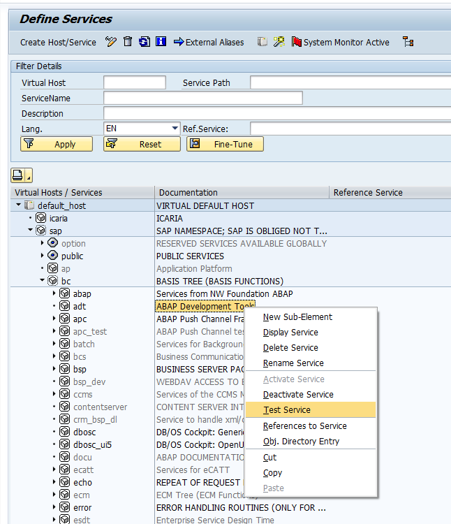
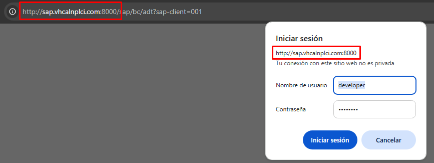

#  IDEA — Integrated Development Environment for ABAP

[Español](README.md) · **English** · [Deutsch](README.de.md) · [Français](README.fr.md)

> 💡 To read this README in another language inside VS Code, run **IDEA: Show README** (`Ctrl+Shift+P`): it opens automatically in your editor's language.

---

## What is **IDEA**?

**IDEA** turns Visual Studio Code (VS Code) into a workspace with an AI assistant connected to your SAP systems. With the *ADT Ampliado* (Extended ADT) component, the AI can investigate, analyse and propose actions and solutions on your own data and your own code.

**IDEA** is also a complete ABAP development environment in which the AI:
- Proposes changes to the source code of your SAP system, which you review and accept or reject.
- Checks against the real system that its solutions are valid: that the class, the function module or the parameters really exist.
- Compares information across several systems (development, integration, production…).
- Investigates and offers you the best solution.

**IDEA** makes sure code changes are safe and that the AI never modifies data in your SAP system: it can only query it.

The cost of the AI is under control too. The assistant that uses **IDEA**'s tools (Claude Code, GitHub Copilot…) is paid by subscription, not by usage. Only the editor's inline code suggestions, which are optional, may use a pay-per-use API (by tokens), and they are configured separately. In other words, two AI models work with **IDEA**: one for the suggestions while you type, and another, your assistant's, which uses **IDEA**'s tools.

## Put AI to work for your business: safe, controlled and affordable

**IDEA** connects an AI to any of your SAP systems so it can work on them: it investigates, analyses and proposes actions and solutions.

Imagine your business is a chain of electronics stores and you use **IDEA** and the AI to answer any of these questions:

**1. Get to know the company**
- What does this company sell? Describe the catalogue in two lines.
- How many products, customers and orders do we have?
- Which is the most expensive product and which the cheapest?
- What product categories are there and how many items does each have?

**2. Sales**
- How much have we invoiced each year? Which year was the best?
- Which 10 products have generated the most money?
- Is there seasonality? In which months do we sell the most?
- What is the average order value? And the largest order ever?
- How many orders are paid, pending invoicing or cancelled?

**3. Customers and map**
- Who are our 5 best customers and which country is each from?
- Which countries do we sell in? Sort them by revenue.
- Which customers have gone the longest without buying from us? (Spot lost customers.)
- Which customer always buys the same product from us?

**4. Products and customer reviews**
- Which products have the best and worst customer reviews?
- Summarise what customers say about the worst-rated one.
- Is there a product that sells a lot but has bad reviews?
- Which supplier provides the best-rated products?

**5. Warehouse**
- Which products are below minimum stock? How much should be restocked?
- Are there products with plenty of stock that hardly sell? (Dead stock.)
- For each product below minimum, who is its supplier and what is their email?

**6. Reasoning and cross-checking data**
- If we stopped working with our largest supplier tomorrow, what share of sales would we lose?
- Which products are often bought together? (Market basket.)
- Write me a 5-point executive report on the health of the business.
- Based on the data, which three actions do you recommend to sell more next year?
- Sales have dropped in some country: find it and explain why it may have happened.

## Modern ABAP development, without leaving VS Code

**IDEA** turns VS Code into a complete ABAP development environment: connected in real time to your SAP system and ready to work side by side with the AI assistant you already use (Claude Code, GitHub Copilot, Cursor…).

No more copying and pasting code between SAP GUI and an AI chat. No more losing track of which object is locked, who touched it or whether it is still waiting to be activated. With IDEA everything happens inside the editor itself, with the same discipline of locks, transport requests and activation you already know from SAP, but with the speed of VS Code and the power of AI.

**In one sentence:** find an object → open it → ask your AI to propose the change (or make it yourself) → save and activate it. All without leaving VS Code, all under control.

**In another sentence 😉:** An IDoc failed? → ask your AI to analyse it and tell you the fix → apply it. All without leaving VS Code, all under control.

---

## Why your team will love it

| | |
|---|---|
| ⚡ **Real speed** | Instant search for programs, classes, interfaces and dictionary objects, with search history. No transactions or nested menus. |
| 🤖 **AI with direct access to SAP** | Built-in MCP server: your AI assistant finds and reads SAP code and data and proposes changes in the editor, with the differences in plain sight. You decide whether to accept them; nothing is saved to SAP without you. |
| 🌐 **Multi-system** | Several MCP servers running at once, one per system: your AI can propose changes in development while querying production data through a query-only connection. |
| 🔒 **Zero surprises** | Display mode by default, explicit lock to change, and transport requests and activation handled exactly as in standard SAP. |
| 🕘 **On-the-fly history** | Every save and every activation is recorded in the editor tab: compare versions or restore an earlier one without leaving the editor. |
| 🎨 **Formatting that respects your diffs** | Its own formatter can be limited to the modified methods, so you don't accidentally reformat whole classes. |
| 🖥️ **Source editor just like SAP GUI** | Editor embedded right in the tab: Display and Edit modes, classes by block or in full, editable descriptions, direct access to text elements, GUI Status/Title, dynpros and local includes, and total control over the waits against SAP. |
| 🐞 **Built-in ABAP debugger** | Breakpoints from the editor and one debugging window per execution in SAP, in parallel: statement, method, function, FORM, exception or message breakpoints, watchpoints, value changes and editable internal tables. |
| 🔎 **Where-used** | Where-used list of the word under the cursor (`Ctrl+Shift+F3`) or of each message of a message class, with the statement of each use and a direct jump to the line. |
| ✉️ **Message classes** | Create and edit message classes (SE91) in a table, with their long text and their list of uses. |
| 🧯 **Dumps from any date, without burning tokens** *(extended feature)* | Your AI finds dumps from any date (not just the last 24 h that standard ADT returns): first a compact list with the key, error and position of each dump; then, only for the one that matters, the ST22 summary and the call stack. Variables or the full dump only when needed. Less text for the AI, fewer tokens and faster answers. |
| 🧩 **Beyond standard ADT** *(extended feature)* | Editing of text elements (REPT), data dictionary, GUI Status/Title and dynpros: everything SAP's ADT won't let you touch outside SAP GUI. |

---

## What IDEA covers compared with other tools

Comparison on SAP ECC with NetWeaver 7.50 between SAP's ADT for Eclipse, other ABAP extensions for VS Code, the ABAP component *ADT Ampliado* (Extended ADT) and IDEA itself.

🟢 Covered · 🟡 Partial · 🔴 Not available · ➖ Handled by standard ADT · **AMP** Requires Extended ADT

| Feature | SAP ADT | Other extensions | Extended ADT | IDEA |
|---|---|---|---|---|
| **Objects with source code** | | | | |
| Programs, includes and reports | 🟢 | 🟢 | ➖ | 🟢 |
| Classes and interfaces | 🟢 | 🟢 | ➖ | 🟢 By blocks (method by method) or whole, as in SE24 |
| Local class includes  `CCDEF · CCIMP · CCMAC · CCAU` | 🟢 | 🟢 | ➖ | 🟢 |
| Function groups and modules | 🟢 | 🟢 | ➖ | 🟢 Group tree; no creation |
| Class descriptions  Short texts of methods, attributes and parameters | 🔴 | 🔴 | 🟢 | 🟢 **AMP** Editable table in the editor |
| CDS views and type groups  `DDLS · TYPE` | 🟢 | 🟢 | ➖ | 🔴 |
| Message classes  `MSAG` | 🟢 | 🟢 | ➖ | 🟢 Creation, table editing, long text and where-used of each message |
| **Data dictionary** | | | | |
| Data elements  `DTEL` | 🔴 | 🔴 | 🟢 | 🟢 **AMP** |
| Domains  `DOMA` | 🔴 | 🔴 | 🟢 | 🟢 **AMP** Fixed values included |
| Structures  `TABL` | 🟢 | 🟢 As source code | 🟢 | 🟢 **AMP** Field editor with navigation |
| Database tables  `TABL` | 🔴 | 🔴 | 🟢 | 🟢 **AMP** |
| Table types  `TTYP` | 🔴 | 🔴 | 🟢 | 🟢 **AMP** |
| **Texts and classic UI** | | | | |
| Text elements  `REPT` · text symbols and selection texts | 🟡 Depends on release | 🟡 Depends on release | 🟢 | 🟢 **AMP** |
| GUI Status / Title  `CUAD` · SE41 | 🔴 | 🔴 | 🟢 | 🟢 **AMP** Create, delete and edit functions, statuses and toolbar |
| Dynpros  `DYNP` · SE51 | 🔴 | 🔴 | 🟢 | 🟢 **AMP** Visual editor for fields and containers |
| **RAP and OData** | | | | |
| RAP business objects  `BDEF · SRVD` · NetWeaver 7.54 or S/4HANA only | 🟢 | 🟡 Depending on the extension, as source code | 🔴 | 🔴 |
| RAP generator  Table, CDS, behaviour and service in one step · NetWeaver 7.54 or S/4HANA only | 🟢 | 🔴 | 🔴 | 🔴 |
| RAP OData services  `SRVB` · service binding and Fiori preview · NetWeaver 7.54 or S/4HANA only | 🟢 | 🔴 | 🔴 | 🔴 |
| **Object lifecycle** | | | | |
| Search objects | 🟢 | 🟢 | ➖ | 🟢 With recent items and history |
| Create code objects  Programs, classes and functions | 🟢 | 🟢 | 🟢 Programs and classes | 🟡 **AMP** Programs, classes and message classes; no functions |
| Create dictionary objects  `DTEL · DOMA · TABL · TTYP` | 🟡 Structures only | 🟡 Structures only | 🟢 | 🟢 **AMP** |
| Display / Edit mode  Explicit object lock, as in SE38 | 🟡 Locks when you start typing | 🟡 Locks when you start typing | 🟢 Any object, dynpros too | 🟢 `Ctrl+F1`, state always visible |
| Transport request on save | 🟢 | 🟢 | 🟢 Open requests and request creation | 🟢 |
| Activation and inactive objects | 🟢 | 🟢 Mass activation | ➖ | 🟢 Warning about modified parts |
| Transport management  Release, change owner, ATC on the request | 🟢 | 🟢 | ➖ | 🔴 |
| Versions and comparison | 🟢 | 🟢 Plus line authorship (blame) | ➖ | 🟡 Session history with diff |
| abapGit | 🟢 Plugin | 🟢 | ➖ | 🔴 |
| **Writing code** | | | | |
| Code completion and go to definition | 🟢 | 🟢 | ➖ | 🟢 `F2` as in SAP GUI |
| Syntax check | 🟢 | 🟢 | ➖ | 🟢 |
| Formatting | 🟢 | 🟢 | ➖ | 🟢 SAP standard or the extension's own (can be limited to the modified methods) |
| Where-used list | 🟢 | 🟢 | ➖ | 🟢 Of the word under the cursor and of each message; with the statement of each use |
| Refactoring  Rename, extract method | 🟢 | 🟡 Quick fixes | ➖ | 🔴 |
| SAP GUI-style utilities  Comment with *, join and split statements, jump between blocks | 🟡 | 🔴 | ➖ | 🟢 |
| AI suggestions in the editor | 🔴 | 🟢 GitHub Copilot | ➖ | 🟢 Claude, Gemini or GitHub Copilot |
| **Testing and analysis** | | | | |
| Debugger | 🟢 | 🟢 | ➖ | 🟢 Several sessions in parallel; all kinds of breakpoints, watchpoints, configurable layout and shortcuts |
| ABAP Unit | 🟢 | 🟢 | ➖ | 🔴 |
| ATC / Code Inspector | 🟢 | 🟢 | ➖ | 🔴 |
| Performance traces | 🟢 | 🟢 | ➖ | 🔴 |
| Dumps from the last 24 hours  ST22 · standard ADT feed | 🟢 | 🟢 | ➖ | 🟡 No screen: gets the dumps through standard ADT to hand them to the AI |
| Dumps from any date  ST22 · between dates, with full detail and call stack | 🔴 Last 24 hours only | 🔴 Last 24 hours only | 🟢 | 🟡 **AMP** No screen: list and detail through Extended ADT, optimised to save AI tokens |
| Data queries  Read-only SELECT | 🟢 Simple queries | 🟢 Simple queries | 🟢 Complex queries | 🟢 **AMP** Complex queries, for the AI |
| **AI and multiple systems** | | | | |
| MCP server for any AI assistant  Claude Code, Copilot, Cursor… | 🔴 | 🟢 Depends on the extension | ➖ | 🟢 The AI proposes changes in the editor; the user accepts or rejects them |
| Several systems at once  For example, development and production | 🟢 | 🟢 | ➖ | 🟢 |
| Query-only connection  For production systems | 🔴 | 🟡 Warning in production | 🟢 | 🟢 The AI can neither propose changes nor modify anything |
| Open unsupported objects in SAP GUI | - | 🟢 SAP GUI or Web GUI | ➖ | 🟢 SAP GUI or Web GUI, straight to the object |

*Extended ADT* is not an editor: it is the ABAP service that gives IDEA what standard ADT does not expose. Without it, IDEA opens the objects marked **AMP** in SAP GUI. On S/4HANA (NetWeaver 7.52 or later) standard ADT ships its own editors for more dictionary objects and for text elements. SAP's AI capabilities (Joule) are not available on ECC. Neither are RAP and RAP OData services: on ECC, OData services are built with SEGW in SAP GUI.

---

## How it works

1. **Set up your SAP connections** with `IDEA: Manage SAP Connections`. Add every SAP system you want to work with: that way, from the AI chat, you can say which system it should work against. Tick the connections whose MCP server should start with VS Code (this does nothing in the SAP systems: it only leaves the MCP server listening on your machine) and choose the one that is active when VS Code opens.
2. **Find the object** you need from the «IDEA» side panel.
3. **Ask your AI** to propose the change, or make it yourself with code completion, formatting and go-to-definition.
4. **Save and activate with a shortcut** (`Ctrl+S` and `Ctrl+F3`). IDEA handles the lock, the transport request and the activation for you.

There is no need to open the object before asking your AI for something: with the MCP connection active, it can find it, read it, open it in the editor and propose the change by itself.

> To get the most out of IDEA, explicitly ask your AI to use IDEA's MCP tools to read from SAP and to propose the changes in the editor.

---

## Source editor: just like SAP GUI, but in VS Code

A source code editor embedded right in the tab (WebView), with the same engine VS Code itself uses (Monaco), built to work against SAP just like in SE24/SE38 and with every operation at hand.

**Edit classes just like in SAP GUI**
- **Full source or by blocks** (`Ctrl+Alt+B`): switch between the whole class or just the method you care about, with its *declaration* on top and its *implementation* below, both editable and sharing the same scroll, just like in SE24.
- **Descriptions**: edit the short texts of attributes, types, methods, events and parameters of the class or interface in their own table, without leaving the editor; they are saved together with the rest of the source.
- **Open component button**: opens the object's text elements (REPT), GUI Status/Title (CUA) and screens (dynpros), and the class's local includes: definitions (`CCDEF`), implementations (`CCIMP`), macros (`CCMAC`) and ABAP Unit test classes (`CCAU`), each one in its own tab.

**Changes proposed by the AI**
- When the AI proposes a change, the *Change proposed by the AI* window opens with the differences between the current and the proposed source, showing the full source or only the changes.
- *Accept* applies the change in the editor as an edit you can undo (`Ctrl+Z`), **without saving to SAP**: you review it, save it and activate it yourself. *Reject* discards it.
- A countdown shows how much time is left to review it; when it reaches zero you are asked whether to keep reviewing or cancel the change.

**Where-used**
- **References button** (`Ctrl+Shift+F3`): lists where the identifier under the cursor is used: class, interface, method, attribute, variable, program, function, type, data element, table, structure or domain.
- Each use shows the object type, its name, the line and the full statement; click the row to open the object at that line.
- From a `MESSAGE e001(zclass)` or a `MESSAGE ID 'ZCLASS' ... NUMBER '001'`, `F2` navigates to the message class with the focus on that message.

**Debugging from the editor**
- **Breakpoint button** (`F9`): sets or removes a breakpoint on the cursor line; it is marked in red in the margin.
- **Execute button** (`Ctrl+F8`): opens the object in Web GUI to launch it and stop at the breakpoints.

**Total control over the waits against SAP**
- While locking, saving, checking, activating or formatting against SAP, the whole editor locks (a layer shows what's happening), so you can't keep typing or launch another action while SAP is responding.
- If SAP takes too long, the editor unlocks itself and warns you, instead of leaving you waiting without knowing what's going on.
- The object's status (*Unmodified*, *Modified, not saved* or *Modified, not activated*) is always visible in the editor's own bar.

**Every operation one click away, in its own toolbar**
- Buttons for Edit/Display, Save, Check, Activate, Search and replace, Version history (with a diff viewer), Session changes, Descriptions, Open component, References, Messages, Maximize and Close, with no need for the command palette.
- **Check** (`Ctrl+F2`) checks the syntax of the current source in SAP without saving it.
- **Maximize** (`Ctrl+K Z`) switches the tab to full screen (VS Code's Zen mode) and restores it.
- **Configurable keyboard shortcuts** per action (*Shortcuts* button), with conflict validation and shared across every VS Code window.
- Snippets, SAP code completion and AI code suggestions (Claude, Gemini or VS Code's models, such as Copilot) right in the editor.

The text element, dictionary, GUI Status/Title, dynpro and message class editors also have their own *Close* button in the toolbar.

---

## ABAP debugger

Debug in VS Code the programs that run in SAP, with a window of its own for each execution.

1. **IDEA: Start ABAP debugging** makes the active connection listen for executions in SAP.
2. Set breakpoints in the editor with `F9` (or with the *Breakpoint* button).
3. Run the program in SAP (for example, with the editor's *Execute* button, which opens it in Web GUI).
4. When the execution reaches a breakpoint, a debugging window opens. If several executions arrive, one window opens for each, in parallel (up to 4; beyond that they are released without opening a window).
5. **IDEA: Stop ABAP debugging** removes the breakpoints set in SAP and closes the sessions.

**The debugging window**
- **Toolbar**: Step into (`F5`), Step over (`F6`), Return (`F7`), Continue (`F8`), breakpoint on the line (`F9`), other breakpoints (`Shift+F9`), watchpoint (`Shift+F4`), list of breakpoints and watchpoints, layout (`F10`) and shortcuts.
- **Fixed header**: program, include, block type and name, line, `SY-SUBRC` and `SY-TABIX`.
- **Code**: always in display mode; methods are shown by blocks, as in the editor. Double-click the line number to set or remove a breakpoint; double-click or `F2` on a variable adds it to *Variables*; `F12` jumps to the statement at the cursor.
- **Variables, Locals and Globals**: name, value, technical type, absolute type and hexadecimal value. Values are changed with the pencil; structures expand; internal tables are shown by pages, with row insertion and deletion. Everything can be copied to the clipboard to paste into a spreadsheet.
- **Navigation**: the call stack (level, event type and event, program, include and line); double-click to view another level.
- **Other breakpoints**: ABAP statement, method (of a global or local class), function, FORM, class-based exception, message or source code, with an optional condition. They are remembered and set again on the program's next execution.
- **Watchpoints**: stop when a variable changes, with an optional condition.
- **Configurable screen layout**: you decide how many rows and columns there are and which frame goes in each cell (Code, Navigation, Variables, Locals, Globals). Layouts are saved by name and apply to all windows; the size of each frame is changed by dragging the bars between them.
- **Configurable keyboard shortcuts** for every action, from the panel itself (*Shortcuts* button) or with the `idea.depuracion.atajos` setting.

---

## Message classes (SE91)

From «SAP object search» (type *Message class*), or navigating with `F2` from a `MESSAGE`, the class opens in an editable table. It works entirely through standard ADT, without the extended component.

- It opens in Display mode; *Edit* locks the class and *Save* saves it, asking for the transport request when needed.
- Table with number, text, length and self-explanatory flag; it can be filtered by column and copied whole to the clipboard.
- Create and delete messages, with validation on save (unique 3-digit numbers, mandatory texts and maximum length).
- For each message: view its **long text**, see **where it is used** (with a direct jump to each use) or open it in SE91.
- With the *New* button of «SAP object search» an empty message class is created and opened in Edit mode.

---

## Quick start

1. Install the extension and reload VS Code.
2. `Ctrl+Shift+P` → **IDEA: Manage SAP Connections** → add your SAP systems.
3. Choose the active connection in the status bar (or tick it as *AutoConnect* so it becomes active by itself when VS Code opens).
4. Connect your AI assistant to the connection's MCP server (see *Active connection and MCP servers* in the technical reference).

Done: the extension now searches, edits, saves and activates against SAP, and your AI assistant can analyse, investigate and propose changes to you.

> 💡 How to get the address of my SAP system.
- Open transaction SICF and run it
- Expand the tree and locate /default_host/sap/bc/adt
- Use the context menu to run the "Test Service" command
- The web browser opens, and the address or URL of the SAP system is the `http(s)://server:port` shown there

---

## MCP server: your AI, working directly in SAP

The MCP server lets an AI assistant query the connected SAP system and propose changes to ABAP code. It does not work on local copies: it reads directly from SAP, and the changes it proposes go through IDEA's editor, with the same lock, transport request and activation guarantees as the rest of the extension.

**What the AI can do:**
- Check which SAP system it is connected to.
- Search objects by name and read their source code.
- Open an object in IDEA's editor.
- Read the source exactly as it is in the editor (with changes not yet saved) and the selection.
- Propose a change in the editor, which you accept or reject.
- Query data in SAP tables and analyse dumps *(extended features)*.

The AI does not save or activate directly in SAP: you do that from the editor once you are happy with the change.

**Connecting from your MCP client:** clients built into VS Code detect it by themselves; in external ones (Claude Code, Cursor…) add an `http` server pointing to `http://127.0.0.1:<port>/mcp` (port configurable per connection, for example `4856`).

---

## 🔐 Security and control

- IDEA does not store source code in the cloud or in files on your machine: everything is read and saved directly against your SAP system, and the open source only lives in the editor tab, which discards it when closed.
- Passwords and API keys are stored encrypted in VS Code's secure storage, never in plain text or in the settings.
- Changes proposed by the AI are always shown as differences and only applied if you accept them; even then, they are not saved to SAP until you save.
- The MCP server only listens on `127.0.0.1` (your own machine).
- Data queries are queries only: they never modify table data.
- If you untick «Allows development» on a connection, you are guaranteed that the AI will never change anything in that system: neither objects nor data.
- The same connection cannot be active in two VS Code windows at once. And, so that one version is never mistaken for another, the same object cannot be edited at the same time with two different connections in the same window (for example, development and production), nor with the same connection in two windows. Displaying it is always allowed.

---

## Extended features (licensed)

With a small component installed in your SAP system (configured in `idea.endpointAmpliacionADT`), IDEA unlocks inside VS Code what not even SAP's standard ADT offers:

- **Data queries**: the AI can query SAP tables (read-only). This is what lets the AI reach its full potential.
- **Dumps from any date (ST22)**, not just the last 24 hours offered by standard ADT, and optimised for the AI: a compact list, detail only for the dump that matters and full data only when needed, so the AI spends far fewer tokens.
- **Create programs and classes** with their empty skeleton.
- **Descriptions of classes and interfaces**: short texts of attributes, methods and parameters, editable in the editor itself.
- **Text elements (REPT)** of programs, classes and interfaces: direct editing, without SE38/SE24.
- **Data dictionary**: data elements, structures, tables, domains and table types, with cross-navigation between them.
- **GUI Status / Title** of programs: create, delete and visually edit functions, statuses and the toolbar.
- **Dynpros (SE51)**: visual editor for fields and containers, with validation on save.

Without this component configured, these actions are still available: they simply open the object in classic SAP GUI instead of VS Code.

📩 **Want the full license for your team or consultancy?** Write to [marcosalmeida@abap.info](mailto:marcosalmeida@abap.info).

---

## Technical reference

<strong>📋 Commands and keyboard shortcuts</strong>

**Source editor shortcuts**

These are the default shortcuts. All of them can be changed from the editor's *Shortcuts* button (or with the `idea.editor.atajosWebview` setting) and, inside the editor, they take precedence over VS Code's. Actions without a default shortcut (History, Changes, Open component, Descriptions, Messages) are always in the toolbar.

| Action | Shortcut | Description |
|---|---|---|
| Edit / Display | `Ctrl+F1` | Switches between Edit mode (locks the object in SAP) and Display mode (releases it). |
| Save | `Ctrl+S` | Formats and saves to SAP. If the object is transportable, asks for the transport request **before** saving anything. |
| Check | `Ctrl+F2` | Checks the syntax of the current source in SAP, without saving it. |
| Activate | `Ctrl+F3` | Saves if there are changes and activates the object in SAP. |
| Cancel editing | `Ctrl+Shift+U` | Discards unsaved changes and returns to Display mode. |
| Format | `Shift+F1` | Formats the source with the configured engine. |
| Close the editor | `Ctrl+W` | Closes the tab; if there are unsaved or unactivated changes, asks for confirmation. |
| Comment / uncomment | `Ctrl+<` | Comments or uncomments the selected lines with `*` in column 1, SAP style. |
| Join lines | `Ctrl+Shift+J` | Joins several lines into a single statement, in as few lines as possible. |
| Split statement | `Ctrl+Shift+K` | Splits a long statement (`SELECT`, `CALL METHOD`, etc.) into several lines. |
| Split DATA / TYPES | `Ctrl+Shift+D` | Splits chained `DATA:` / `TYPES:` declarations into individual statements. |
| Block list | `Ctrl+Alt+M` | Filterable list to jump to a METHOD, FORM, MODULE or event in the source. |
| Go to block start / end | `Ctrl+Shift+↑` / `Ctrl+Shift+↓` | Jumps to the start or end of the block the cursor is in. |
| Block view / full source | `Ctrl+Alt+B` | (Classes) Switches between the whole class and the current method. |
| Go to definition | `F2` | Navigates to the definition of the object under the cursor, as in SAP GUI. |
| Go back / forward | `Alt+←` / `Alt+→` | Moves through the positions visited while navigating. |
| Find / replace in the editor | `Ctrl+F` / `Ctrl+H` | The editor's own quick find and replace. |
| Search and replace (window) | `Ctrl+Shift+F` | Search window by whole or partial word, in the current block or the whole source, with a filterable list of results and replacement preview. |
| Where-used list | `Ctrl+Shift+F3` | Where the identifier under the cursor is used. |
| Close error messages | `Ctrl+Q` | Closes all the error messages visible in the editor. |
| Breakpoint on the line | `F9` | Sets or removes a breakpoint on the cursor line. |
| Run in Web GUI | `Ctrl+F8` | Opens the object in Web GUI to run it. |
| Maximize / restore | `Ctrl+K Z` | Switches the tab to full screen (VS Code's Zen mode) and restores it. Not configurable. |

Also: SAP code completion (`Ctrl+Space`) and code folding.

**VS Code commands** (`Ctrl+Shift+P`)

| Command | Description |
|---|---|
| `IDEA: Manage SAP Connections` | Adds, edits or deletes the available SAP systems. |
| `IDEA: Switch Active Connection` | Chooses which SAP system this window works against. Also by clicking the connection in the status bar. |
| `IDEA: Close All Connections` | Closes the active connection and stops this window's MCP servers. |
| `IDEA: Start MCP Server` | Starts the MCP server of a connection. |
| `IDEA: Stop MCP Server` | Stops a running MCP server. |
| `IDEA: Start ABAP debugging` | Makes the active connection listen for executions in SAP; each one that stops at a breakpoint opens its debugging window. |
| `IDEA: Breakpoint on the current line` | Sets or removes a breakpoint on the cursor line (`F9` in the editor). |
| `IDEA: Stop ABAP debugging` | Removes the breakpoints set in SAP, stops listening and closes the debugging windows. |
| `IDEA: Open SAP GUI` | Opens a classic SAP GUI window against the connection you choose. |
| `IDEA: Save the Anthropic API key` | Stores, encrypted, the key for AI suggestions with Claude. |
| `IDEA: Save the Gemini API key` | Stores, encrypted, the key for AI suggestions with Gemini. |
| `IDEA: Show README (VS Code language)` | Opens this README in the editor's language. |

<strong>⚙️ Full configuration</strong>

Settings under `idea.*` (File → Preferences → Settings, or from the «Settings» section of the IDEA panel).

**Formatting (Pretty Printer)**

| Option | Values | What it does |
|---|---|---|
| `idea.prettyprinter.formateadorAUsar` | `extension` (default), `sapConfig` | Engine used by *Format* and on save. `extension`: the built-in formatter. `sapConfig`: the Pretty Printer configured in SAP. |
| `idea.prettyprinter.indentation` | `true` (default), `false` | Enables or disables automatic indentation. |
| `idea.prettyprinter.removeDoubleSpaces` | `true` (default), `false` | Removes double spaces or not. |
| `idea.prettyprinter.caseSetting` | `upperKeywords` (default), `lowerKeywords`, `upperAll`, `lowerAll` | Upper/lower case: keywords only, or all code. |
| `idea.prettyprinter.methodBaseIndent` | `auto` (default), `modoSe24`, `estandar` | Indentation of `METHOD` / `ENDMETHOD` (classes only). `auto`: keeps existing spaces. `modoSe24`: column 0. `estandar`: one level (2 spaces). |
| `idea.prettyprinter.formatScope` | `fullFile` (default), `currentMethodOnly` | Formatting scope in classes and interfaces: the whole source, or only the method at the cursor (on save, only the modified methods). |

**Source editor**

| Option | Values | What it does |
|---|---|---|
| `idea.codeCompletion.insertParameterComments` | `true` (default), `false` | When inserting a method or function call with `Ctrl+Space`, includes each parameter's comment. With `false` only the parameters are inserted. |
| `idea.editor.sugerenciasIa.proveedor` | `desactivado` (default), `vscode`, `anthropic`, `gemini` | Inline AI code suggestions (ghost text; `Tab` accepts them), only in Edit mode and after 500 ms without typing. `vscode`: the models already available in VS Code (for example, Copilot), without your own key. `anthropic` and `gemini`: the corresponding API with your key. |
| `idea.editor.sugerenciasIa.modelo` | Model name (empty by default) | Model for the suggestions. With `vscode`, the model family; with `anthropic` or `gemini`, the model identifier. Empty: the provider's default. |
| `idea.editor.atajosWebview` | Object action → key combination | Source editor shortcuts that differ from the defaults (empty string = no shortcut). Changed from the editor's *Shortcuts* button. |

**Connections and MCP server**

| Option | Values | What it does |
|---|---|---|
| `idea.mcpServer.connections` | List of SAP systems | Available systems. Edited with «IDEA: Manage SAP Connections». The password is **not** stored here: it is requested and stored encrypted in VS Code's secure storage. Fields of each connection in the next table. |
| `idea.mcpServer.config` → `mcpInicial` | Name of a connection (empty by default) | Connection that is **active** when VS Code opens. Empty = none. |
| `idea.mcpServer.confirmWrites` | `true` (default), `false` | Asks for confirmation (showing a diff) before the AI saves or activates directly in SAP. Those tools are currently not published to the AI: its changes always arrive as a proposal in the editor. |

**Fields of each connection**

| Field | Required | What it does |
|---|---|---|
| Name | Yes | System identifier (e.g. `DEV`, `QAS`). It is the name the AI and the status bar use to refer to it. |
| URL | Yes | Base URL of the SAP system (e.g. `https://myserver.mydomain.com:44300`). |
| Client | Yes | SAP client (e.g. `100`). |
| User | Yes | SAP user. |
| MCP port | Yes | Local port (`127.0.0.1`) of this connection's MCP server. Must be different for each connection. |
| Language | No | SAP logon language. Does not change the extension's language, which always follows VS Code. |
| Allow untrusted certificates | No (`false`) | Accepts self-signed TLS certificates for this system. |
| SAP system ID (SID) | No | SID as it appears in your SAP Logon. Needed to open classic SAP GUI. |
| Allows development | No (`true`) | If unticked, the connection is **query-only**: the AI can only search, read, open in Display mode, query data and analyse dumps; it can neither propose changes nor save or activate. Intended for production systems. |
| Silent startup | No (`false`) | Starts this connection's MCP server when VS Code opens, without asking. Several connections can be ticked to have several servers running at once. |

**Debugger**

| Option | Values | What it does |
|---|---|---|
| `idea.depuracion.atajos` | Object action → key combination | Debugging window shortcuts that differ from the defaults: `F5` step into, `F6` step over, `F7` return, `F8` continue, `F9` breakpoint, `Shift+F9` other breakpoints, `Shift+F4` watchpoint, `F2` add variable, `F12` jump to statement, `F10` layout. They can also be changed from the panel's *Shortcuts* button. |

**Extended features and SAP GUI**

| Option | Values | What it does |
|---|---|---|
| `idea.endpointAmpliacionADT` | Service path (empty by default), e.g. `/sap/serviciosazure/` | Enables the extended features (data queries, dumps from any date, descriptions, text elements, dictionary, GUI Status/Title, dynpros). If left empty, those actions open the object in SAP GUI. |
| `idea.sapGui.sapshcutPath` | Path to `sapshcut.exe` (empty by default) | Only if SAP GUI is not in a standard location or on the PATH. |
| `idea.navigation.gui` | `sapGui` (default), `webGui` | When navigating to an object the extension doesn't edit, chooses between classic SAP GUI (`sapshcut.exe`; needs the *SAP system ID*) or Web GUI in the browser. |

<strong>🔌 Active connection and MCP servers</strong>

IDEA distinguishes two concepts:

- **Active connection**: the SAP system *this window* of VS Code works against (search, editing, activation). It is shown and changed from the status bar. When VS Code opens, the one set in `mcpInicial` is activated. The same connection cannot be active in two windows at once. When switching connections, IDEA first closes everything open from the previous one (asking for confirmation if there are unsaved changes).
- **MCP servers**: one per connection, each on its own port. Several can run at once, so the AI can work in DEV and query QAS in parallel.

**Connecting your MCP client:**
- **Clients built into VS Code**: IDEA automatically publishes the active connection's server (`IDEA – <connection>`); nothing to configure.
- **External clients** (Claude Code, Cursor…): add an `http` server pointing to `http://127.0.0.1:<port>/mcp`, with the connection's *MCP port*. One per connection you want to use.

**MCP tools available to the AI**

| Tool | What it does | Query only |
|---|---|:---:|
| `abap_connection_info` | Tells which SAP system the server is connected to. | ✅ |
| `abap_search_object` | Searches objects by name (accepts `*` as a wildcard). | ✅ |
| `abap_read_object_source` | Reads an object's source code from SAP. | ✅ |
| `abap_open_object` | Opens an object in IDEA's source editor. | ✅ |
| `abap_editor_get_fuente` | Reads the source exactly as it is in the editor, with changes not yet saved, and its state: mode, current block, cursor and selection. | ✅ |
| `abap_editor_get_seleccion` | Reads the text selected in the editor and its position. | ✅ |
| `abap_editor_proponer_cambio` | Proposes a change to the source open in the editor: the user sees the differences and accepts or rejects it. If accepted, it is applied in the editor (it can be undone), without saving to SAP. | — |
| `abap_editor_esperar_propuesta` | Keeps waiting for the user's decision on a proposed change when the review takes longer than the MCP client allows a single call to wait. | — |
| `abap_get_datos` | Accesses the SAP system in read-only mode to read its data *(extended feature)*. | ✅ |
| `abap_list_dumps_24h` | Lists runtime dumps from the last 24 hours (standard ADT feed). | ✅ |
| `abap_list_dumps` | Lists runtime dumps from any date (equivalent to ST22), in compact form *(extended feature)*. | ✅ |
| `abap_get_dump_detalle` | Returns the detail of a dump: ST22 summary and call stack; variables or the full dump only on request *(extended feature)*. | ✅ |

The *Query only* column shows the tools available on connections with **Allows development** unticked.

For safety, the tools that saved or activated directly in SAP (`abap_write_object_source`, `abap_activate_object` and `abap_llamar_herramienta_desarrollo`) are not published to the AI: the AI proposes, and you review, save and activate from the editor.

<strong>🖥️ The «IDEA» side panel in detail</strong>

The IDEA icon in the activity bar opens two sections. Code search and version history live inside the source editor itself (*Search* and *History* buttons).

**1. SAP object search**: searches objects in the SAP system of the active connection and opens them in VS Code (requires the connection's MCP server running). The name accepts `*` as a wildcard.
- **Program / Report**, **Class** and **Function module**: opened in the source editor, in Display mode.
- **Classes**: buttons to open their local includes: `<DEF LOCAL>`, `<IMPL LOCAL>`, `<MACROS>` and `<TEST>` (ABAP Unit test classes).
- **Function groups**: shows their tree (function modules, includes and other parts) to open each piece separately.
- **Data element**, **Structure / Table**, **Domain** and **Table type**: opened in the dictionary editor *(extended feature)*.
- **REPT, CUA and DYNP buttons** (depending on the object type): open the text element, GUI Status/Title and dynpro editors *(extended features)*.
- **Message class**: opens in the message class editor (through standard ADT, without the extended component).
- **New button**: creates a program, a class, a message class or a dictionary object (data element, domain, structure/table, table type) given a name and package. Without the extended component only message classes can be created.
- If the search returns a single result, it opens directly. Keeps **recent** and **history** searches.
- Objects the extension can't edit are opened in classic SAP GUI (or in Web GUI, depending on `idea.navigation.gui`).

**2. Settings**: quick access, without leaving the panel, to:
- SAP connections: table with *Name*, *Silent start* (its MCP server starts when VS Code opens), *AutoConnect* (the one that is active when VS Code opens) and *Development* (whether it allows development); the other details (URL, client, user, MCP port) appear when hovering over the row. *Manage connections…* button.
- Pretty Printer: engine, scope, indentation, double spaces, upper/lower case and `METHOD` indentation.
- MCP server: initial connection and write confirmation.
- Navigation and SAP GUI: where to open non-editable objects, path to `sapshcut.exe` and the ADT extension service.
- Code completion and AI suggestions: parameter comments, provider, model and API key.

**Version history** (editor's *History* button): keeps a version of the object every time a real change is saved or activated, and also when it detects that the object was changed directly in SAP. It only belongs to the tab: it is lost when the tab is closed.
- Table with the most recent version at the top, the time of the change, whether it was activated, its origin (*Local* or *Changed in SAP*) and the number of changes compared with the last activation and the previous version.
- *View changes* between two versions (inline or side by side) and *View total changes* between the initial and the current version.
- *Restore version*: puts its content in the editor, without saving it (it can be undone).

<strong>🧩 Extended features in detail</strong>

**Data queries.** They let the AI investigate the data in your SAP system with read-only queries. Without them, the AI sees the code but not the data, and loses much of its analytical ability.

**Text element editor (REPT).** From the *REPT* button in «SAP object search» (or *Open component* in the editor), on a program, class or interface:
- Opens in Display mode (blue background).
- *Edit* locks the object in SAP (amber background); changing any cell shows 🔴 on the tab.
- *Save and activate* uploads the texts to SAP (asking for a transport request if needed) and keeps the lock so you can keep editing.
- Returning to Display mode or closing the tab releases the lock.
- *Copy* puts the whole text table on the clipboard.

**Dictionary editor.** Data elements, structures / tables, domains and table types: header, technical options and list of fields or values. Opens in Display mode; *Edit* locks the object and lets you change and activate it with the same transport request handling as the rest. The field table header stays fixed when scrolling; columns can be sorted and filtered. From the cells you can navigate to other data elements and domains.

**GUI Status / Title (CUA).** Create, delete and edit titles, functions, statuses and the standard toolbar.

**Dynpros (SE51).** Visual editor for fields and containers (frames, subscreens, tabstrips, table controls): add an element by placing it with a click, overlap detection and validation on save.

All of them follow the same lock, transport request and activation discipline as the rest of the objects.

---

## License

The extension is free to use under the MIT license.

If you are interested in the extended features, which require the ABAP component *ADT Ampliado* (Extended ADT), contact Marcos Almeida Santolaria at [marcosalmeida@abap.info](mailto:marcosalmeida@abap.info) for terms and pricing.

---

[Español](README.md) · **English** · [Deutsch](README.de.md) · [Français](README.fr.md)
