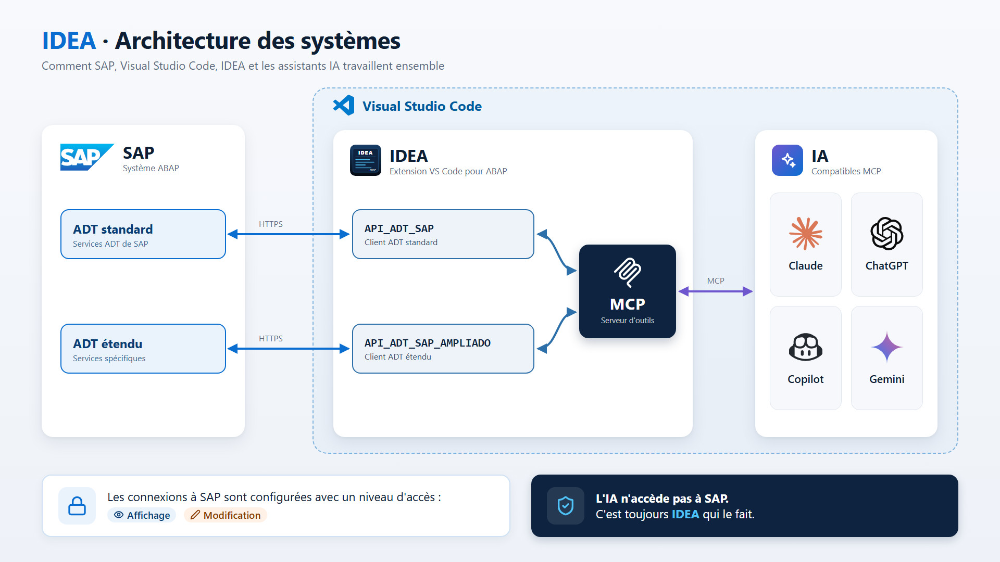

#  IDEA — Environnement de Développement Intégré pour ABAP

[Español](README.md) · [English](README.en.md) · [Deutsch](README.de.md) · **Français**

> 💡 Pour lire ce README dans une autre langue dans VS Code, exécutez **IDEA : Afficher le README** (`Ctrl+Shift+P`) : il s'ouvre automatiquement dans la langue de votre éditeur.

---

## Qu'est-ce qu'**IDEA** ?

**IDEA** transforme Visual Studio Code (VS Code) en un espace de travail doté d'un assistant IA connecté à vos systèmes SAP. Avec le composant *ADT Ampliado* (ADT étendu), l'IA peut enquêter, analyser et proposer des actions et des solutions à partir de vos propres données et de votre propre code.

**IDEA** est aussi un environnement de développement ABAP complet dans lequel l'IA :
- Propose des modifications du code source de votre système SAP, que vous examinez puis acceptez ou refusez.
- Vérifie sur le système réel que ses solutions sont valables : que la classe, le module fonction ou les paramètres existent vraiment.
- Compare des informations entre plusieurs systèmes (développement, intégration, production…).
- Enquête et vous propose la meilleure solution.

**IDEA** veille à ce que les modifications du code soient sûres et à ce que l'IA ne modifie jamais les données de votre système SAP : elle peut seulement les consulter.

Le coût de l'IA reste lui aussi maîtrisé. L'assistant qui utilise les outils d'**IDEA** (Claude Code, GitHub Copilot…) est payé par abonnement, pas à la consommation. Seules les suggestions de code en ligne de l'éditeur, qui sont facultatives, peuvent utiliser une API payée à l'usage (aux tokens), et elles se configurent à part. Autrement dit, deux modèles d'IA travaillent avec **IDEA** : l'un pour les suggestions pendant la saisie, l'autre, celui de votre assistant, qui utilise les outils d'**IDEA**.

## Mettez l'IA au service de votre entreprise, de façon sûre, maîtrisée et économique

**IDEA** connecte une IA à n'importe lequel de vos systèmes SAP pour qu'elle y travaille : elle enquête, analyse et propose des actions et des solutions.

Imaginez que votre entreprise soit une chaîne de magasins d'électronique et que vous utilisiez **IDEA** et l'IA pour répondre à des questions comme celles-ci :

**1. Connaître l'entreprise**
- Que vend cette entreprise ? Décris-moi le catalogue en deux lignes.
- Combien de produits, de clients et de commandes avons-nous ?
- Quel est le produit le plus cher et le moins cher ?
- Quelles catégories de produits existent et combien d'articles compte chacune ?

**2. Ventes**
- Combien avons-nous facturé chaque année ? Quelle a été la meilleure année ?
- Quels sont les 10 produits qui ont rapporté le plus ?
- Y a-t-il une saisonnalité ? Quels mois vend-on le plus ?
- Quel est le montant moyen d'une commande ? Et la plus grosse commande de l'histoire ?
- Combien de commandes sont payées, en attente de facturation ou annulées ?

**3. Clients et carte**
- Qui sont nos 5 meilleurs clients et de quel pays est chacun ?
- Dans quels pays vendons-nous ? Classe-les par chiffre d'affaires.
- Quels clients ne nous ont plus acheté depuis le plus longtemps ? (Détecter les clients perdus.)
- Quel client nous achète toujours le même produit ?

**4. Produits et avis clients**
- Quels sont les produits les mieux et les moins bien notés dans les avis clients ?
- Résume-moi ce que disent les clients du produit le moins bien noté.
- Y a-t-il un produit qui se vend beaucoup mais a de mauvais avis ?
- Quel fournisseur nous livre les produits les mieux notés ?

**5. Entrepôt**
- Quels produits sont sous le stock minimum ? Combien faudrait-il réapprovisionner ?
- Y a-t-il des produits avec beaucoup de stock qui se vendent à peine ? (Stock dormant.)
- Pour chaque produit sous le minimum, qui est son fournisseur et quelle est son adresse e-mail ?

**6. Raisonner et croiser les données**
- Si demain nous cessions de travailler avec notre plus gros fournisseur, quelle part des ventes perdrions-nous ?
- Quels produits sont souvent achetés ensemble ? (Panier d'achat.)
- Fais-moi un rapport de synthèse en 5 points sur la santé de l'entreprise.
- Quelles trois actions me recommandes-tu, d'après les données, pour vendre plus l'an prochain ?
- Les ventes ont chuté dans un pays : trouve-le et explique pourquoi cela a pu arriver.

## Le développement ABAP moderne, sans quitter VS Code

**IDEA** transforme VS Code en un environnement de développement ABAP complet : connecté en temps réel à votre système SAP et prêt à travailler main dans la main avec l'assistant IA que vous utilisez déjà (Claude Code, GitHub Copilot, Cursor…).

Fini le copier-coller de code entre SAP GUI et un chat IA. Fini de perdre de vue quel objet est verrouillé, qui l'a modifié ou s'il attend encore d'être activé. Avec IDEA, tout se passe dans l'éditeur lui-même, avec la même rigueur de verrous, d'ordres de transport et d'activation que vous connaissez déjà dans SAP, mais avec la rapidité de VS Code et la puissance de l'IA.

**En une phrase :** cherchez un objet → ouvrez-le → demandez à votre IA de proposer la modification (ou faites-la vous-même) → sauvegardez-le et activez-le. Le tout sans quitter VS Code, le tout sous contrôle.

**En une autre phrase 😉 :** Un IDoc a échoué ? → demandez à votre IA de l'analyser et de vous indiquer la solution → appliquez-la. Le tout sans quitter VS Code, le tout sous contrôle.

---

## Pourquoi votre équipe va l'adorer

| | |
|---|---|
| ⚡ **Vraie rapidité** | Recherche instantanée de programmes, classes, interfaces et objets du dictionnaire, avec historique des recherches. Sans transactions ni menus imbriqués. |
| 🤖 **IA avec accès direct à SAP** | Serveur MCP intégré : votre assistant IA cherche et lit le code et les données de SAP et vous propose les modifications dans l'éditeur, avec les différences sous les yeux. C'est vous qui décidez de les accepter ; rien n'est sauvegardé dans SAP sans vous. |
| 🌐 **Multi-système** | Plusieurs serveurs MCP en même temps, un par système : votre IA peut proposer des modifications en développement tout en consultant des données de production via une connexion en consultation seule. |
| 🔒 **Zéro surprise** | Mode Affichage par défaut, verrou explicite pour modifier, ordres de transport et activation gérés exactement comme dans SAP standard. |
| 🕘 **Historique à la volée** | Chaque sauvegarde et chaque activation sont consignées dans l'onglet de l'éditeur : comparez des versions ou restaurez-en une ancienne sans quitter l'éditeur. |
| 🎨 **Un formatage qui respecte vos diffs** | Formateur propre qui peut se limiter aux méthodes modifiées, pour ne pas reformater des classes entières par accident. |
| 🖥️ **Éditeur de source comme dans SAP GUI** | Éditeur intégré directement dans l'onglet : modes Affichage et Modification, classes par blocs ou complètes, descriptions modifiables, accès direct aux éléments de texte, au GUI Status/Title, aux dynpros et aux includes locaux, et contrôle total des temps d'attente face à SAP. |
| 🐞 **Débogueur ABAP intégré** | Points d'arrêt depuis l'éditeur et une fenêtre de débogage par exécution dans SAP, en parallèle : points d'arrêt d'instruction, de méthode, de fonction, de FORM, d'exception ou de message, watchpoints, modification des valeurs et tables internes modifiables. |
| 🔎 **Liste des utilisations** | Utilisations du mot sous le curseur (`Ctrl+Shift+F3`) ou de chaque message d'une classe de messages, avec l'instruction de chaque utilisation et un saut direct à la ligne. |
| ✉️ **Classes de messages** | Création et édition des classes de messages (SE91) dans un tableau, avec leur texte explicatif et leur liste d'utilisations. |
| 🧯 **Dumps de n'importe quelle date, sans gaspiller de tokens** *(fonction étendue)* | Votre IA trouve les dumps de n'importe quelle date (pas seulement ceux des dernières 24 h de l'ADT standard) : d'abord une liste compacte avec la clé, l'erreur et la position de chaque dump ; ensuite, uniquement pour celui qui compte, le résumé ST22 et la pile d'appels. Les variables ou le dump complet seulement si nécessaire. Moins de texte pour l'IA, moins de tokens et des réponses plus rapides. |
| 🧩 **Au-delà de l'ADT standard** *(fonction étendue)* | Édition des éléments de texte (REPT), du dictionnaire de données, du GUI Status/Title et des dynpros : tout ce que l'ADT de SAP ne permet pas de modifier hors de SAP GUI. |

---

## Ce que couvre IDEA par rapport aux autres outils

Comparatif sur SAP ECC avec NetWeaver 7.50 entre l'ADT de SAP pour Eclipse, d'autres extensions ABAP pour VS Code, le composant ABAP *ADT Ampliado* (ADT étendu) et IDEA elle-même.

🟢 Couvert · 🟡 Partiel · 🔴 Non disponible · ➖ Pris en charge par l'ADT standard · **AMP** Nécessite l'ADT étendu

| Fonctionnalité | SAP ADT | Autres extensions | ADT étendu | IDEA |
|---|---|---|---|---|
| **Objets avec code source** | | | | |
| Programmes, includes et reports | 🟢 | 🟢 | ➖ | 🟢 |
| Classes et interfaces | 🟢 | 🟢 | ➖ | 🟢 Par blocs (méthode par méthode) ou complète, comme dans SE24 |
| Includes locaux de classe  `CCDEF · CCIMP · CCMAC · CCAU` | 🟢 | 🟢 | ➖ | 🟢 |
| Groupes et modules fonction | 🟢 | 🟢 | ➖ | 🟢 Arbre du groupe ; sans création |
| Descriptions de classe  Textes courts des méthodes, attributs et paramètres | 🔴 | 🔴 | 🟢 | 🟢 **AMP** Tableau modifiable dans l'éditeur |
| Vues CDS et groupes de types  `DDLS · TYPE` | 🟢 | 🟢 | ➖ | 🔴 |
| Classes de messages  `MSAG` | 🟢 | 🟢 | ➖ | 🟢 Création, édition en tableau, texte explicatif et utilisations de chaque message |
| **Dictionnaire de données** | | | | |
| Éléments de données  `DTEL` | 🔴 | 🔴 | 🟢 | 🟢 **AMP** |
| Domaines  `DOMA` | 🔴 | 🔴 | 🟢 | 🟢 **AMP** Valeurs fixes incluses |
| Structures  `TABL` | 🟢 | 🟢 Comme code source | 🟢 | 🟢 **AMP** Éditeur de champs avec navigation |
| Tables de base de données  `TABL` | 🔴 | 🔴 | 🟢 | 🟢 **AMP** |
| Types de table  `TTYP` | 🔴 | 🔴 | 🟢 | 🟢 **AMP** |
| **Textes et interface classique** | | | | |
| Éléments de texte  `REPT` · symboles de texte et textes de sélection | 🟡 Selon la release | 🟡 Selon la release | 🟢 | 🟢 **AMP** |
| GUI Status / Title  `CUAD` · SE41 | 🔴 | 🔴 | 🟢 | 🟢 **AMP** Création, suppression et édition des fonctions, status et barre d'outils |
| Dynpros  `DYNP` · SE51 | 🔴 | 🔴 | 🟢 | 🟢 **AMP** Éditeur visuel des champs et conteneurs |
| **RAP et OData** | | | | |
| Objets métier RAP  `BDEF · SRVD` · uniquement NetWeaver 7.54 ou S/4HANA | 🟢 | 🟡 Selon l'extension, comme code source | 🔴 | 🔴 |
| Générateur RAP  Table, CDS, comportement et service en une seule étape · uniquement NetWeaver 7.54 ou S/4HANA | 🟢 | 🔴 | 🔴 | 🔴 |
| Services OData RAP  `SRVB` · service binding et aperçu Fiori · uniquement NetWeaver 7.54 ou S/4HANA | 🟢 | 🔴 | 🔴 | 🔴 |
| **Cycle de vie de l'objet** | | | | |
| Rechercher des objets | 🟢 | 🟢 | ➖ | 🟢 Avec récents et historique |
| Créer des objets de code  Programmes, classes et fonctions | 🟢 | 🟢 | 🟢 Programmes et classes | 🟡 **AMP** Programmes, classes et classes de messages ; pas de fonctions |
| Créer des objets du dictionnaire  `DTEL · DOMA · TABL · TTYP` | 🟡 Structures seulement | 🟡 Structures seulement | 🟢 | 🟢 **AMP** |
| Mode Affichage / Édition  Verrouillage explicite de l'objet, comme dans SE38 | 🟡 Verrouille dès qu'on commence à écrire | 🟡 Verrouille dès qu'on commence à écrire | 🟢 Tout objet, dynpros compris | 🟢 `Ctrl+F1`, état toujours visible |
| Ordre de transport à la sauvegarde | 🟢 | 🟢 | 🟢 Ordres ouverts et création d'ordre | 🟢 |
| Activation et objets inactifs | 🟢 | 🟢 Activation en masse | ➖ | 🟢 Avertissement des parties modifiées |
| Gestion des ordres  Libérer, changer de propriétaire, ATC sur l'ordre | 🟢 | 🟢 | ➖ | 🔴 |
| Versions et comparaison | 🟢 | 🟢 Plus l'auteur par ligne (blame) | ➖ | 🟡 Historique de la session avec diff |
| abapGit | 🟢 Plugin | 🟢 | ➖ | 🔴 |
| **Écrire du code** | | | | |
| Autocomplétion et aller à la définition | 🟢 | 🟢 | ➖ | 🟢 `F2` comme dans SAP GUI |
| Contrôle de syntaxe | 🟢 | 🟢 | ➖ | 🟢 |
| Formatage | 🟢 | 🟢 | ➖ | 🟢 Standard SAP ou propre à l'extension (peut se limiter aux méthodes modifiées) |
| Liste des utilisations | 🟢 | 🟢 | ➖ | 🟢 Du mot sous le curseur et de chaque message ; avec l'instruction de chaque utilisation |
| Refactorisation  Renommer, extraire une méthode | 🟢 | 🟡 Corrections rapides | ➖ | 🔴 |
| Utilitaires façon SAP GUI  Commenter avec *, joindre et scinder des instructions, sauter entre blocs | 🟡 | 🔴 | ➖ | 🟢 |
| Suggestions d'IA dans l'éditeur | 🔴 | 🟢 GitHub Copilot | ➖ | 🟢 Claude, Gemini ou GitHub Copilot |
| **Tester et analyser** | | | | |
| Débogueur | 🟢 | 🟢 | ➖ | 🟢 Plusieurs sessions en parallèle ; points d'arrêt de tout type, watchpoints, disposition et raccourcis configurables |
| ABAP Unit | 🟢 | 🟢 | ➖ | 🔴 |
| ATC / Code Inspector | 🟢 | 🟢 | ➖ | 🔴 |
| Traces de performance | 🟢 | 🟢 | ➖ | 🔴 |
| Dumps des dernières 24 heures  ST22 · flux ADT standard | 🟢 | 🟢 | ➖ | 🟡 Sans écran : récupère les dumps via l'ADT standard pour les transmettre à l'IA |
| Dumps de n'importe quelle date  ST22 · entre deux dates, avec détail complet et pile d'appels | 🔴 Uniquement les dernières 24 heures | 🔴 Uniquement les dernières 24 heures | 🟢 | 🟡 **AMP** Sans écran : liste et détail via l'ADT étendu, optimisés pour économiser les tokens de l'IA |
| Requêtes de données  SELECT en lecture seule | 🟢 Requêtes simples | 🟢 Requêtes simples | 🟢 Requêtes complexes | 🟢 **AMP** Requêtes complexes, pour l'IA |
| **IA et plusieurs systèmes** | | | | |
| Serveur MCP pour tout assistant d'IA  Claude Code, Copilot, Cursor… | 🔴 | 🟢 Dépend de l'extension | ➖ | 🟢 L'IA propose les modifications dans l'éditeur ; l'utilisateur les accepte ou les refuse |
| Plusieurs systèmes à la fois  Par exemple, développement et production | 🟢 | 🟢 | ➖ | 🟢 |
| Connexion en consultation seule  Pour les systèmes de production | 🔴 | 🟡 Avertissement en production | 🟢 | 🟢 L'IA ne peut ni proposer de modifications ni rien modifier |
| Ouvrir dans SAP GUI ce qui n'est pas pris en charge | - | 🟢 SAP GUI ou Web GUI | ➖ | 🟢 SAP GUI ou Web GUI, directement sur l'objet |

L'*ADT étendu* n'est pas un éditeur : c'est le service ABAP qui donne à IDEA ce que l'ADT standard n'expose pas. Sans lui, IDEA ouvre dans SAP GUI les objets marqués **AMP**. Sous S/4HANA (NetWeaver 7.52 ou supérieur), l'ADT standard fournit ses propres éditeurs pour davantage d'objets du dictionnaire et pour les éléments de texte. Les capacités d'IA de SAP (Joule) ne sont pas disponibles sous ECC. RAP et les services OData RAP non plus : sous ECC, les services OData sont créés avec SEGW dans SAP GUI.

---

## Comment ça marche

1. **Configurez vos connexions SAP** avec `IDEA : Gérer les connexions SAP`. Ajoutez tous les systèmes SAP avec lesquels vous voulez travailler : vous pourrez ainsi indiquer, depuis le chat de l'IA, sur quel système elle doit travailler. Cochez les connexions dont le serveur MCP doit démarrer avec VS Code (cela ne fait rien dans les systèmes SAP : le serveur MCP se contente d'écouter sur votre machine) et choisissez celle qui est active à l'ouverture de VS Code.
2. **Cherchez l'objet** dont vous avez besoin depuis le panneau latéral «IDEA».
3. **Demandez à votre IA** de proposer la modification, ou faites-la vous-même avec autocomplétion, formatage et navigation vers les définitions.
4. **Sauvegardez et activez avec un raccourci** (`Ctrl+S` et `Ctrl+F3`). IDEA gère pour vous le verrou, l'ordre de transport et l'activation.

Inutile d'ouvrir l'objet avant de demander quelque chose à votre IA : avec la connexion MCP active, elle peut elle-même le chercher, le lire, l'ouvrir dans l'éditeur et vous proposer la modification.

> Pour que votre IA exploite tout le potentiel d'IDEA, demandez-lui explicitement d'utiliser les outils MCP d'IDEA pour lire dans SAP et proposer les modifications dans l'éditeur.

---

## Éditeur de source : comme dans SAP GUI, mais dans VS Code

Un éditeur de code source intégré directement dans l'onglet (WebView), avec le même moteur que VS Code (Monaco), pensé pour travailler face à SAP exactement comme dans SE24/SE38, avec toutes les opérations à portée de main.

**Modifiez les classes comme dans SAP GUI**
- **Source complet ou par blocs** (`Ctrl+Alt+B`) : basculez entre la classe entière et seulement la méthode qui vous intéresse, avec sa *déclaration* en haut et son *implémentation* en bas, toutes deux modifiables et partageant le même défilement, exactement comme dans SE24.
- **Descriptions** : modifiez dans un tableau dédié les textes courts des attributs, types, méthodes, événements et paramètres de la classe ou de l'interface, sans quitter l'éditeur ; ils sont sauvegardés avec le reste du source.
- **Bouton Ouvrir le composant** : ouvre les éléments de texte (REPT), le GUI Status/Title (CUA) et les écrans (dynpros) de l'objet, ainsi que les includes locaux de la classe : définitions (`CCDEF`), implémentations (`CCIMP`), macros (`CCMAC`) et classes de test ABAP Unit (`CCAU`), chacun dans son propre onglet.

**Modifications proposées par l'IA**
- Quand l'IA propose une modification, la fenêtre *Modification proposée par l'IA* s'ouvre avec les différences entre le source actuel et le source proposé, en affichant le source complet ou les modifications seules.
- *Accepter* applique la modification dans l'éditeur sous forme d'édition annulable (`Ctrl+Z`), **sans sauvegarder dans SAP** : vous l'examinez, la sauvegardez et l'activez vous-même. *Refuser* l'écarte.
- Un compte à rebours indique le temps restant pour l'examiner ; à zéro, on vous demande si vous continuez la vérification ou si vous annulez la modification.

**Liste des utilisations**
- **Bouton Références** (`Ctrl+Shift+F3`) : liste où est utilisé l'identifiant sous le curseur : classe, interface, méthode, attribut, variable, programme, fonction, type, élément de données, table, structure ou domaine.
- Chaque utilisation affiche le type d'objet, son nom, la ligne et l'instruction complète ; un clic sur la ligne ouvre l'objet à cet endroit.
- Depuis un `MESSAGE e001(zclasse)` ou un `MESSAGE ID 'ZCLASSE' ... NUMBER '001'`, `F2` navigue vers la classe de messages avec le focus sur ce message.

**Débogage depuis l'éditeur**
- **Bouton Point d'arrêt** (`F9`) : pose ou retire un point d'arrêt sur la ligne du curseur ; il est marqué en rouge dans la marge.
- **Bouton Exécuter** (`Ctrl+F8`) : ouvre l'objet dans Web GUI pour le lancer et qu'il s'arrête aux points d'arrêt.

**Contrôle total des temps d'attente face à SAP**
- Pendant qu'il verrouille, sauvegarde, vérifie, active ou formate face à SAP, l'éditeur se verrouille entièrement (une couche indique ce qui se passe), pour empêcher de continuer à taper ou de lancer une autre action tant que SAP n'a pas répondu.
- Si SAP met trop de temps, l'éditeur se déverrouille de lui-même et vous prévient, au lieu de vous laisser attendre sans savoir ce qui se passe.
- Le statut de l'objet (*Non modifié*, *Modifié, non sauvegardé* ou *Modifié, non activé*) est toujours visible dans la barre de l'éditeur.

**Toutes les opérations à un clic, dans sa propre barre d'outils**
- Boutons Modifier/Afficher, Sauvegarder, Vérifier, Activer, Rechercher et remplacer, Historique des versions (avec comparateur de différences), Modifications de la session, Descriptions, Ouvrir le composant, Références, Messages, Agrandir et Fermer, sans passer par la palette de commandes.
- **Vérifier** (`Ctrl+F2`) contrôle la syntaxe du source actuel dans SAP sans le sauvegarder.
- **Agrandir** (`Ctrl+K Z`) passe l'onglet en plein écran (mode Zen de VS Code) et le restaure.
- **Raccourcis clavier configurables** par action (bouton *Raccourcis*), avec validation des conflits et communs à toutes les fenêtres de VS Code.
- Extraits de code (snippets), autocomplétion face à SAP et suggestions de code par IA (Claude, Gemini ou les modèles de VS Code, comme Copilot) directement dans l'éditeur.

Les éditeurs d'éléments de texte, de dictionnaire, de GUI Status/Title, de dynpros et de classes de messages ont eux aussi leur bouton *Fermer* dans la barre.

---

## Débogueur ABAP

Déboguez dans VS Code les programmes qui s'exécutent dans SAP, avec une fenêtre dédiée pour chaque exécution.

1. **IDEA : Démarrer le débogage ABAP** met la connexion active à l'écoute des exécutions dans SAP.
2. Posez des points d'arrêt dans l'éditeur avec `F9` (ou avec le bouton *Point d'arrêt*).
3. Exécutez le programme dans SAP (par exemple, avec le bouton *Exécuter* de l'éditeur, qui l'ouvre dans Web GUI).
4. Quand l'exécution atteint un point d'arrêt, une fenêtre de débogage s'ouvre. Si plusieurs exécutions arrivent, une fenêtre s'ouvre pour chacune, en parallèle (jusqu'à 4 ; au-delà, elles sont libérées sans ouvrir de fenêtre).
5. **IDEA : Arrêter le débogage ABAP** retire de SAP les points d'arrêt posés et ferme les sessions.

**La fenêtre de débogage**
- **Barre d'outils** : Pas à pas (`F5`), Exécuter (`F6`), Retour (`F7`), Continuer (`F8`), point d'arrêt sur la ligne (`F9`), autres points d'arrêt (`Shift+F9`), watchpoint (`Shift+F4`), liste des points d'arrêt et watchpoints, disposition (`F10`) et raccourcis.
- **En-tête fixe** : programme, include, type et nom du bloc, ligne, `SY-SUBRC` et `SY-TABIX`.
- **Code** : toujours en affichage ; les méthodes s'affichent par blocs, comme dans l'éditeur. Double-clic sur le numéro de ligne pour poser ou retirer un point d'arrêt ; double-clic ou `F2` sur une variable l'ajoute à *Variables* ; `F12` saute à l'instruction du curseur.
- **Variables, Locales et Globales** : nom, valeur, type technique, type absolu et valeur hexadécimale. Les valeurs se modifient avec le crayon ; les structures se déplient ; les tables internes s'affichent par pages, avec ajout et suppression de lignes. Tout peut être copié dans le presse-papiers pour le coller dans un tableur.
- **Navigation** : la pile d'appels (niveau, type d'événement et événement, programme, include et ligne) ; double-clic pour voir un autre niveau.
- **Autres points d'arrêt** : d'instruction ABAP, de méthode (de classe globale ou locale), de fonction, de FORM, d'exception de classe, de message ou de code source, avec condition facultative. Ils sont mémorisés et reposés à la prochaine exécution du programme.
- **Watchpoints** : s'arrêtent quand une variable change, avec condition facultative.
- **Disposition de l'écran configurable** : vous choisissez le nombre de lignes et de colonnes et le cadre de chaque cellule (Code, Navigation, Variables, Locales, Globales). Les dispositions s'enregistrent sous un nom et valent pour toutes les fenêtres ; la taille de chaque cadre se change en faisant glisser les barres qui les séparent.
- **Raccourcis clavier configurables** pour toutes les actions, depuis le panneau lui-même (bouton *Raccourcis*) ou avec le paramètre `idea.depuracion.atajos`.

---

## Classes de messages (SE91)

Depuis la «Recherche d'objet SAP» (type *Classe de messages*), ou en naviguant avec `F2` depuis un `MESSAGE`, la classe s'ouvre dans un tableau modifiable. Elle passe entièrement par l'ADT standard, sans le composant étendu.

- Elle s'ouvre en Mode Affichage ; *Modifier* verrouille la classe et *Enregistrer* l'enregistre en demandant l'ordre de transport si nécessaire.
- Tableau avec numéro, texte, longueur et indicateur « auto-explicatif » ; il se filtre par colonne et peut être copié entier dans le presse-papiers.
- Création et suppression de messages, avec contrôle à l'enregistrement (numéros à 3 chiffres sans doublon, textes obligatoires et longueur maximale).
- Pour chaque message : voir son **texte explicatif**, voir **où il est utilisé** (avec saut direct vers chaque utilisation) ou l'ouvrir dans SE91.
- Le bouton *Nouveau* de la «Recherche d'objet SAP» crée une classe de messages vide et l'ouvre en Mode Édition.

---

## Démarrage rapide

1. Installez l'extension et rechargez VS Code.
2. `Ctrl+Shift+P` → **IDEA : Gérer les connexions SAP** → ajoutez vos systèmes SAP.
3. Choisissez la connexion active dans la barre d'état (ou cochez-la comme *AutoConnexion* pour qu'elle s'active seule à l'ouverture de VS Code).
4. Connectez votre assistant IA au serveur MCP de la connexion (voir *Connexion active et serveurs MCP* dans la référence technique).

C'est prêt : l'extension recherche, modifie, sauvegarde et active déjà sur SAP, et votre assistant IA peut analyser, enquêter et vous proposer des modifications.

> 💡 Comment obtenir l'adresse de mon environnement SAP.
- Ouvrez la transaction SICF et exécutez-la
- Dépliez l'arborescence et localisez /default_host/sap/bc/adt
- Utilisez le menu contextuel pour exécuter la commande « Tester service »
- Le navigateur web s'ouvre et l'adresse ou URL du système SAP est le `http(s)://serveur:port` affiché

---

## Serveur MCP : votre IA, qui travaille directement dans SAP

Le serveur MCP permet à un assistant IA de consulter le système SAP connecté et de proposer des modifications du code ABAP. Il ne travaille pas sur des copies locales : il lit directement dans SAP, et les modifications qu'il propose passent par l'éditeur d'IDEA, avec les mêmes garanties de verrou, d'ordre de transport et d'activation que le reste de l'extension.

**Ce que l'IA peut faire :**
- Savoir à quel système SAP elle est connectée.
- Chercher des objets par nom et lire leur code source.
- Ouvrir un objet dans l'éditeur d'IDEA.
- Lire le source tel qu'il est dans l'éditeur (avec les modifications pas encore sauvegardées) et la sélection.
- Proposer une modification dans l'éditeur, que vous acceptez ou refusez.
- Consulter les données des tables SAP et analyser les dumps *(fonctions étendues)*.

L'IA ne sauvegarde ni n'active directement dans SAP : c'est vous qui le faites depuis l'éditeur, une fois la modification validée.

**Connexion depuis votre client MCP :** les clients intégrés à VS Code le détectent tout seuls ; dans les clients externes (Claude Code, Cursor…), ajoutez un serveur de type `http` pointant vers `http://127.0.0.1:<port>/mcp` (port configurable pour chaque connexion, par exemple `4856`).

  

---

## 🔐 Sécurité et contrôle

- IDEA ne stocke aucun code source dans le cloud ni dans des fichiers de votre ordinateur : tout est lu et sauvegardé directement sur votre système SAP, et le source ouvert ne vit que dans l'onglet de l'éditeur, qui l'écarte à sa fermeture.
- Les mots de passe et les clés d'API sont stockés chiffrés dans le stockage sécurisé de VS Code, jamais en clair ni dans la configuration.
- Les modifications proposées par l'IA sont toujours affichées sous forme de différences et ne s'appliquent que si vous les acceptez ; même alors, elles ne sont pas sauvegardées dans SAP tant que vous ne sauvegardez pas.
- Le serveur MCP n'écoute que sur `127.0.0.1` (votre propre machine).
- Les requêtes de données sont uniquement des requêtes : elles ne modifient jamais les données des tables.
- Si vous décochez «Développement autorisé» sur une connexion, vous avez la garantie que l'IA ne modifiera jamais rien dans ce système : ni objets ni données.
- Une même connexion ne peut pas être active dans deux fenêtres de VS Code à la fois. Et, pour ne jamais confondre une version avec une autre, un même objet ne peut pas être modifié en même temps avec deux connexions différentes dans la même fenêtre (par exemple, développement et production), ni avec la même connexion dans deux fenêtres. L'afficher est toujours possible.

---

## Fonctions étendues (sous licence)

Avec un petit composant installé dans votre système SAP (configuré dans `idea.endpointAmpliacionADT`), IDEA débloque dans VS Code ce que même l'ADT standard de SAP n'offre pas :

- **Requêtes de données** : l'IA peut consulter les tables SAP (lecture seule). C'est ce qui permet à l'IA de donner toute sa mesure.
- **Dumps de n'importe quelle date (ST22)**, pas seulement ceux des dernières 24 heures de l'ADT standard, et optimisés pour l'IA : liste compacte, détail uniquement du dump qui compte et données complètes seulement si nécessaire, si bien que l'IA consomme beaucoup moins de tokens.
- **Créer des programmes et des classes** avec leur structure vide.
- **Descriptions des classes et interfaces** : textes courts des attributs, méthodes et paramètres, modifiables dans l'éditeur lui-même.
- **Éléments de texte (REPT)** des programmes, classes et interfaces : édition directe, sans SE38/SE24.
- **Dictionnaire de données** : éléments de données, structures, tables, domaines et types de table, avec navigation croisée entre eux.
- **GUI Status / Title** des programmes : création, suppression et édition visuelle des fonctions, status et barre d'outils.
- **Dynpros (SE51)** : éditeur visuel des champs et conteneurs, avec validation à la sauvegarde.

Sans ce composant, ces actions restent disponibles : elles ouvrent simplement l'objet dans SAP GUI classique au lieu de VS Code.

📩 **Vous voulez la licence complète pour votre équipe ou votre cabinet de conseil ?** Écrivez à [marcosalmeida@abap.info](mailto:marcosalmeida@abap.info).

---

## Référence technique

<strong>📋 Commandes et raccourcis clavier</strong>

**Raccourcis de l'éditeur de source**

Ce sont les raccourcis par défaut. Tous se modifient depuis le bouton *Raccourcis* de l'éditeur (ou avec le paramètre `idea.editor.atajosWebview`) et, dans l'éditeur, ils ont priorité sur ceux de VS Code. Les actions sans raccourci par défaut (Historique, Modifications, Ouvrir le composant, Descriptions, Messages) sont toujours dans la barre d'outils.

| Action | Raccourci | Description |
|---|---|---|
| Modifier / Afficher | `Ctrl+F1` | Bascule entre le Mode Édition (verrouille l'objet dans SAP) et le Mode Affichage (le libère). |
| Sauvegarder | `Ctrl+S` | Formate et sauvegarde dans SAP. Si l'objet est transportable, demande l'ordre de transport **avant** de sauvegarder quoi que ce soit. |
| Vérifier | `Ctrl+F2` | Contrôle la syntaxe du source actuel dans SAP, sans le sauvegarder. |
| Activer | `Ctrl+F3` | Sauvegarde s'il y a des modifications et active l'objet dans SAP. |
| Annuler l'édition | `Ctrl+Shift+U` | Abandonne les modifications non sauvegardées et revient en Mode Affichage. |
| Formater | `Shift+F1` | Formate le source avec le moteur configuré. |
| Fermer l'éditeur | `Ctrl+W` | Ferme l'onglet ; s'il y a des modifications non sauvegardées ou non activées, demande confirmation. |
| Commenter / décommenter | `Ctrl+<` | Commente ou décommente les lignes sélectionnées avec `*` en colonne 1, à la manière de SAP. |
| Fusionner les lignes | `Ctrl+Shift+J` | Fusionne plusieurs lignes en une seule instruction, en le moins de lignes possible. |
| Diviser l'instruction | `Ctrl+Shift+K` | Divise une longue instruction (`SELECT`, `CALL METHOD`, etc.) en plusieurs lignes. |
| Diviser DATA / TYPES | `Ctrl+Shift+D` | Sépare les déclarations chaînées `DATA:` / `TYPES:` en instructions individuelles. |
| Liste des blocs | `Ctrl+Alt+M` | Liste filtrable pour sauter à un METHOD, FORM, MODULE ou événement du source. |
| Aller au début / à la fin du bloc | `Ctrl+Shift+↑` / `Ctrl+Shift+↓` | Saute au début ou à la fin du bloc où se trouve le curseur. |
| Vue par blocs / source complet | `Ctrl+Alt+B` | (Classes) Bascule entre la classe entière et la méthode courante. |
| Atteindre la définition | `F2` | Navigue vers la définition de l'objet sous le curseur, comme dans SAP GUI. |
| Retour / avancer | `Alt+←` / `Alt+→` | Parcourt les positions visitées pendant la navigation. |
| Rechercher / remplacer dans l'éditeur | `Ctrl+F` / `Ctrl+H` | Recherche et remplacement rapides de l'éditeur lui-même. |
| Rechercher et remplacer (fenêtre) | `Ctrl+Shift+F` | Fenêtre de recherche par mot entier ou partiel, dans le bloc courant ou dans tout le source, avec liste de résultats filtrable et aperçu du remplacement. |
| Liste des utilisations | `Ctrl+Shift+F3` | Où est utilisé l'identifiant sous le curseur. |
| Fermer les messages d'erreur | `Ctrl+Q` | Ferme tous les messages d'erreur visibles dans l'éditeur. |
| Point d'arrêt sur la ligne | `F9` | Pose ou retire un point d'arrêt sur la ligne du curseur. |
| Exécuter dans Web GUI | `Ctrl+F8` | Ouvre l'objet dans Web GUI pour l'exécuter. |
| Agrandir / restaurer | `Ctrl+K Z` | Passe l'onglet en plein écran (mode Zen de VS Code) et le restaure. Non configurable. |

En plus : autocomplétion face à SAP (`Ctrl+Space`) et repli du code.

**Commandes de VS Code** (`Ctrl+Shift+P`)

| Commande | Description |
|---|---|
| `IDEA : Gérer les connexions SAP` | Ajoute, modifie ou supprime les systèmes SAP disponibles. |
| `IDEA : Changer de connexion active` | Choisit le système SAP sur lequel travaille cette fenêtre. Aussi en cliquant sur la connexion dans la barre d'état. |
| `IDEA : Fermer toutes les connexions` | Ferme la connexion active et arrête les serveurs MCP de cette fenêtre. |
| `IDEA : Démarrer le serveur MCP` | Démarre le serveur MCP d'une connexion. |
| `IDEA : Arrêter le serveur MCP` | Arrête un serveur MCP en cours d'exécution. |
| `IDEA : Démarrer le débogage ABAP` | Met la connexion active à l'écoute des exécutions dans SAP ; chacune qui s'arrête sur un point d'arrêt ouvre sa fenêtre de débogage. |
| `IDEA : Point d'arrêt sur la ligne courante` | Pose ou retire un point d'arrêt sur la ligne du curseur (`F9` dans l'éditeur). |
| `IDEA : Arrêter le débogage ABAP` | Retire de SAP les points d'arrêt posés, arrête l'écoute et ferme les fenêtres de débogage. |
| `IDEA : Ouvrir SAP GUI` | Ouvre une fenêtre SAP GUI classique sur la connexion choisie. |
| `IDEA : Enregistrer la clé de l'API Anthropic` | Enregistre, chiffrée, la clé des suggestions d'IA avec Claude. |
| `IDEA : Enregistrer la clé de l'API Gemini` | Enregistre, chiffrée, la clé des suggestions d'IA avec Gemini. |
| `IDEA : Afficher le README (langue de VS Code)` | Ouvre ce README dans la langue de l'éditeur. |

<strong>⚙️ Configuration complète</strong>

Paramètres sous `idea.*` (Fichier → Préférences → Paramètres, ou depuis la section «Configuration» du panneau IDEA).

**Formatage (Pretty Printer)**

| Option | Valeurs | Rôle |
|---|---|---|
| `idea.prettyprinter.formateadorAUsar` | `extension` (par défaut), `sapConfig` | Moteur utilisé par *Formater* et à la sauvegarde. `extension` : le formateur intégré. `sapConfig` : le Pretty Printer configuré dans SAP. |
| `idea.prettyprinter.indentation` | `true` (par défaut), `false` | Active ou non l'indentation automatique. |
| `idea.prettyprinter.removeDoubleSpaces` | `true` (par défaut), `false` | Supprime ou non les doubles espaces. |
| `idea.prettyprinter.caseSetting` | `upperKeywords` (par défaut), `lowerKeywords`, `upperAll`, `lowerAll` | Majuscules/minuscules : mots-clés seulement, ou tout le code. |
| `idea.prettyprinter.methodBaseIndent` | `auto` (par défaut), `modoSe24`, `estandar` | Indentation de `METHOD` / `ENDMETHOD` (classes uniquement). `auto` : conserve les espaces existants. `modoSe24` : colonne 0. `estandar` : un niveau (2 espaces). |
| `idea.prettyprinter.formatScope` | `fullFile` (par défaut), `currentMethodOnly` | Portée du formatage dans les classes et interfaces : tout le source, ou seulement la méthode du curseur (à la sauvegarde, seulement les méthodes modifiées). |

**Éditeur de source**

| Option | Valeurs | Rôle |
|---|---|---|
| `idea.codeCompletion.insertParameterComments` | `true` (par défaut), `false` | Lors de l'insertion d'un appel de méthode ou de fonction avec `Ctrl+Space`, inclut le commentaire de chaque paramètre. Avec `false`, seuls les paramètres sont insérés. |
| `idea.editor.sugerenciasIa.proveedor` | `desactivado` (par défaut), `vscode`, `anthropic`, `gemini` | Suggestions de code par IA en ligne (texte fantôme ; `Tab` les accepte), uniquement en Mode Édition et après 500 ms sans frappe. `vscode` : les modèles déjà disponibles dans VS Code (par exemple, Copilot), sans clé propre. `anthropic` et `gemini` : l'API correspondante avec votre clé. |
| `idea.editor.sugerenciasIa.modelo` | Nom du modèle (vide par défaut) | Modèle des suggestions. Avec `vscode`, la famille du modèle ; avec `anthropic` ou `gemini`, l'identifiant du modèle. Vide : le modèle par défaut du fournisseur. |
| `idea.editor.atajosWebview` | Objet action → combinaison | Raccourcis de l'éditeur de source qui diffèrent de ceux par défaut (chaîne vide = aucun raccourci). Se modifient depuis le bouton *Raccourcis* de l'éditeur. |

**Connexions et serveur MCP**

| Option | Valeurs | Rôle |
|---|---|---|
| `idea.mcpServer.connections` | Liste des systèmes SAP | Systèmes disponibles. Se modifie avec «IDEA : Gérer les connexions SAP». Le mot de passe n'est **pas** stocké ici : il est demandé puis stocké chiffré dans le stockage sécurisé de VS Code. Champs de chaque connexion dans le tableau suivant. |
| `idea.mcpServer.config` → `mcpInicial` | Nom d'une connexion (vide par défaut) | Connexion **active** à l'ouverture de VS Code. Vide = aucune. |
| `idea.mcpServer.confirmWrites` | `true` (par défaut), `false` | Demande une confirmation (avec un diff) avant que l'IA ne sauvegarde ou n'active directement dans SAP. Ces outils ne sont pour l'instant pas publiés à l'IA : ses modifications arrivent toujours sous forme de proposition dans l'éditeur. |

**Champs de chaque connexion**

| Champ | Obligatoire | Rôle |
|---|---|---|
| Nom | Oui | Identifiant du système (ex. `DEV`, `QAS`). C'est le nom sous lequel l'IA et la barre d'état y font référence. |
| URL | Oui | URL de base du système SAP (ex. `https://monserveur.mondomaine.com:44300`). |
| Client (mandant) | Oui | Mandant SAP (ex. `100`). |
| Utilisateur | Oui | Utilisateur SAP. |
| Port MCP | Oui | Port local (`127.0.0.1`) du serveur MCP de cette connexion. Doit être différent pour chaque connexion. |
| Langue | Non | Langue de connexion SAP. Ne change pas la langue de l'extension, qui suit toujours celle de VS Code. |
| Autoriser les certificats non approuvés | Non (`false`) | Accepte les certificats TLS auto-signés pour ce système. |
| ID du système SAP (SID) | Non | SID tel qu'il apparaît dans votre SAP Logon. Nécessaire pour ouvrir SAP GUI classique. |
| Développement autorisé | Non (`true`) | Si décoché, la connexion est en **consultation seule** : l'IA peut seulement chercher, lire, ouvrir en Affichage, consulter des données et analyser les dumps ; elle ne peut ni proposer de modifications, ni sauvegarder, ni activer. Prévu pour les systèmes de production. |
| Démarrage silencieux | Non (`false`) | Démarre le serveur MCP de cette connexion à l'ouverture de VS Code, sans rien demander. Plusieurs connexions peuvent être cochées pour avoir plusieurs serveurs en même temps. |

**Débogueur**

| Option | Valeurs | Rôle |
|---|---|---|
| `idea.depuracion.atajos` | Objet action → combinaison | Raccourcis de la fenêtre de débogage qui diffèrent de ceux par défaut : `F5` pas à pas, `F6` exécuter, `F7` retour, `F8` continuer, `F9` point d'arrêt, `Shift+F9` autres points d'arrêt, `Shift+F4` watchpoint, `F2` ajouter une variable, `F12` sauter à l'instruction, `F10` disposition. Ils se modifient aussi depuis le bouton *Raccourcis* du panneau. |

**Fonctions étendues et SAP GUI**

| Option | Valeurs | Rôle |
|---|---|---|
| `idea.endpointAmpliacionADT` | Chemin du service (vide par défaut), p. ex. `/sap/serviciosazure/` | Active les fonctions étendues (requêtes de données, dumps de n'importe quelle date, descriptions, éléments de texte, dictionnaire, GUI Status/Title, dynpros). S'il reste vide, ces actions ouvrent l'objet dans SAP GUI. |
| `idea.sapGui.sapshcutPath` | Chemin vers `sapshcut.exe` (vide par défaut) | Uniquement si SAP GUI n'est pas à un emplacement standard ni dans le PATH. |
| `idea.navigation.gui` | `sapGui` (par défaut), `webGui` | Lors de la navigation vers un objet que l'extension ne modifie pas : SAP GUI classique (`sapshcut.exe` ; nécessite l'*ID du système SAP*) ou Web GUI dans le navigateur. |

<strong>🔌 Connexion active et serveurs MCP</strong>

IDEA distingue deux notions :

- **Connexion active** : le système SAP sur lequel travaille *cette fenêtre* de VS Code (recherche, édition, activation). Elle s'affiche et se change depuis la barre d'état. À l'ouverture de VS Code, celle indiquée dans `mcpInicial` est activée. Une même connexion ne peut pas être active dans deux fenêtres à la fois. En changeant de connexion, IDEA ferme d'abord tout ce qui est ouvert de la précédente (en demandant confirmation s'il y a des modifications non sauvegardées).
- **Serveurs MCP** : un par connexion, chacun sur son propre port. Plusieurs peuvent tourner en même temps, de sorte que l'IA peut travailler en DEV et consulter QAS en parallèle.

**Connecter votre client MCP :**
- **Clients intégrés à VS Code** : IDEA publie automatiquement le serveur de la connexion active (`IDEA – <connexion>`) ; rien à configurer.
- **Clients externes** (Claude Code, Cursor…) : ajoutez un serveur de type `http` pointant vers `http://127.0.0.1:<port>/mcp`, avec le *port MCP* de la connexion. Un par connexion que vous voulez utiliser.

**Outils MCP disponibles pour l'IA**

| Outil | Rôle | Consultation seule |
|---|---|:---:|
| `abap_connection_info` | Indique à quel système SAP le serveur est connecté. | ✅ |
| `abap_search_object` | Cherche des objets par nom (accepte `*` comme joker). | ✅ |
| `abap_read_object_source` | Lit dans SAP le code source d'un objet. | ✅ |
| `abap_open_object` | Ouvre un objet dans l'éditeur de source d'IDEA. | ✅ |
| `abap_editor_get_fuente` | Lit le source tel qu'il est dans l'éditeur, avec les modifications pas encore sauvegardées, et son état : mode, bloc courant, curseur et sélection. | ✅ |
| `abap_editor_get_seleccion` | Lit le texte sélectionné dans l'éditeur et sa position. | ✅ |
| `abap_editor_proponer_cambio` | Propose une modification du source ouvert dans l'éditeur : l'utilisateur voit les différences et l'accepte ou la refuse. Si elle est acceptée, elle est appliquée dans l'éditeur (annulable), sans sauvegarder dans SAP. | — |
| `abap_editor_esperar_propuesta` | Continue d'attendre la décision de l'utilisateur sur une modification proposée lorsque l'examen dure plus longtemps que ce que le client MCP permet d'attendre en un seul appel. | — |
| `abap_get_datos` | Accède à l'environnement SAP en lecture seule pour en lire les données *(fonction étendue)*. | ✅ |
| `abap_list_dumps_24h` | Liste les dumps d'exécution des dernières 24 heures (flux ADT standard). | ✅ |
| `abap_list_dumps` | Liste les dumps d'exécution de n'importe quelle date (équivalent de ST22), sous forme compacte *(fonction étendue)*. | ✅ |
| `abap_get_dump_detalle` | Renvoie le détail d'un dump : résumé ST22 et pile d'appels ; les variables ou le dump complet seulement sur demande *(fonction étendue)*. | ✅ |

La colonne *Consultation seule* indique les outils disponibles sur les connexions avec **Développement autorisé** décoché.

Par sécurité, les outils qui sauvegardaient ou activaient directement dans SAP (`abap_write_object_source`, `abap_activate_object` et `abap_llamar_herramienta_desarrollo`) ne sont pas publiés à l'IA : l'IA propose, et vous examinez, sauvegardez et activez depuis l'éditeur.

<strong>🖥️ Le panneau latéral «IDEA» en détail</strong>

L'icône d'IDEA dans la barre d'activité ouvre deux sections. La recherche dans le code et l'historique des versions se trouvent dans l'éditeur de source lui-même (boutons *Rechercher* et *Historique*).

**1. Recherche d'objet SAP** : cherche des objets dans le système SAP de la connexion active et les ouvre dans VS Code (nécessite le serveur MCP de la connexion démarré). Le nom accepte `*` comme joker.
- **Programme / Report**, **Classe** et **Module fonction** : s'ouvrent dans l'éditeur de source, en Mode Affichage.
- **Classes** : boutons pour ouvrir leurs includes locaux : `<DEF LOCAL>`, `<IMPL LOCAL>`, `<MACROS>` et `<TEST>` (classes de test ABAP Unit).
- **Groupes de fonctions** : affiche leur arborescence (modules fonction, includes et autres parties) pour ouvrir chaque élément séparément.
- **Élément de données**, **Structure / Table**, **Domaine** et **Type de table** : s'ouvrent dans l'éditeur de dictionnaire *(fonction étendue)*.
- **Boutons REPT, CUA et DYNP** (selon le type d'objet) : ouvrent les éditeurs d'éléments de texte, de GUI Status/Title et de dynpros *(fonctions étendues)*.
- **Classe de messages** : s'ouvre dans l'éditeur de classes de messages (via l'ADT standard, sans le composant étendu).
- **Bouton Nouveau** : crée un programme, une classe, une classe de messages ou un objet du dictionnaire (élément de données, domaine, structure/table, type de table) en indiquant le nom et le paquet. Sans le composant étendu, seules les classes de messages peuvent être créées.
- Si la recherche renvoie un seul résultat, il s'ouvre directement. Conserve les recherches **récentes** et l'**historique**.
- Les objets que l'extension ne sait pas modifier s'ouvrent dans SAP GUI classique (ou dans Web GUI, selon `idea.navigation.gui`).

**2. Configuration** : accès rapide, sans quitter le panneau, à :
- Connexions SAP : tableau avec *Nom*, *Démarrage silen.* (son serveur MCP démarre à l'ouverture de VS Code), *AutoConnexion* (celle qui est active à l'ouverture de VS Code) et *Développement* (développement autorisé ou non) ; les autres informations (URL, mandant, utilisateur, port MCP) apparaissent au survol de la ligne. Bouton *Gérer les connexions…*.
- Pretty Printer : moteur, portée, indentation, doubles espaces, majuscules/minuscules et indentation de `METHOD`.
- Serveur MCP : connexion initiale et confirmation des écritures.
- Navigation et SAP GUI : où ouvrir les objets non modifiables, chemin de `sapshcut.exe` et service d'extension ADT.
- Autocomplétion et suggestions d'IA : commentaires des paramètres, fournisseur, modèle et clé d'API.

**Historique des versions** (bouton *Historique* de l'éditeur) : conserve une version de l'objet à chaque sauvegarde ou activation d'une vraie modification, et aussi lorsqu'il détecte que l'objet a été modifié directement dans SAP. Il n'appartient qu'à l'onglet : il est perdu à sa fermeture.
- Tableau avec la version la plus récente en haut, l'heure de la modification, si elle a été activée, son origine (*Local* ou *Modifié dans SAP*) et le nombre de modifications par rapport à la dernière activation et à la version précédente.
- *Voir les modifications* entre deux versions (vue en ligne ou côte à côte) et *Voir les modifications totales* entre la version initiale et l'actuelle.
- *Restaurer la version* : place son contenu dans l'éditeur, sans le sauvegarder (annulable).

<strong>🧩 Fonctions étendues en détail</strong>

**Requêtes de données.** Elles permettent à l'IA d'explorer les données de votre système SAP avec des requêtes en lecture seule. Sans elles, l'IA voit le code mais pas les données, et perd une bonne partie de sa capacité d'analyse.

**Éditeur d'éléments de texte (REPT).** Depuis le bouton *REPT* de la «Recherche d'objet SAP» (ou *Ouvrir le composant* dans l'éditeur), sur un programme, une classe ou une interface :
- S'ouvre en Mode Affichage (fond bleu).
- *Modifier* verrouille l'objet dans SAP (fond ambre) ; toute modification de cellule fait apparaître 🔴 sur l'onglet.
- *Enregistrer et activer* envoie les textes à SAP (en demandant un ordre de transport si nécessaire) et conserve le verrou pour continuer à modifier.
- Revenir en Affichage ou fermer l'onglet libère le verrou.
- *Copier* place tout le tableau des textes dans le presse-papiers.

**Éditeur de dictionnaire.** Éléments de données, structures / tables, domaines et types de table : en-tête, options techniques et liste des champs ou valeurs. S'ouvre en Affichage ; *Modifier* verrouille l'objet et permet de le modifier et de l'activer avec la même gestion des ordres de transport que le reste. L'en-tête du tableau des champs reste fixe au défilement ; colonnes triables et filtrables. Depuis les cellules, on navigue vers d'autres éléments de données et domaines.

**GUI Status / Title (CUA).** Création, suppression et édition des titres, fonctions, status et de la barre d'outils standard.

**Dynpros (SE51).** Éditeur visuel des champs et conteneurs (cadres, subscreens, tabstrips, table controls) : ajout en plaçant l'élément d'un clic, détection des chevauchements et validation à la sauvegarde.

Tous suivent la même rigueur de verrou, d'ordre de transport et d'activation que les autres objets.

---

## Licence

L'extension est d'utilisation libre sous licence MIT.

Si les fonctions étendues vous intéressent, qui nécessitent le composant ABAP *ADT Ampliado* (ADT étendu), contactez Marcos Almeida Santolaria à [marcosalmeida@abap.info](mailto:marcosalmeida@abap.info) pour les conditions et les tarifs.

---

[Español](README.md) · [English](README.en.md) · [Deutsch](README.de.md) · **Français**
