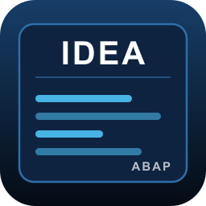

#  IDEA — Entorno de Desarrollo Integrado de ABAP

**Español** · [English](README.en.md) · [Deutsch](README.de.md) · [Français](README.fr.md)

> 💡 Para leer este README en otro idioma dentro de VS Code, ejecuta **IDEA: Mostrar README** (`Ctrl+Shift+P`): se abre automáticamente en el idioma de tu editor.

---

## Desarrollo ABAP moderno, sin salir de VS Code

**IDEA** convierte Visual Studio Code en un entorno de desarrollo ABAP completo: conectado en tiempo real a tu sistema SAP y preparado para trabajar codo con codo con el asistente de IA que ya uses (Claude Code, GitHub Copilot, Cursor…).

Se acabó copiar y pegar código entre SAP GUI y un chat de IA. Se acabó perder de vista qué objeto está bloqueado, quién lo tocó o si sigue pendiente de activar. Con IDEA todo ocurre dentro del propio editor, con la misma disciplina de bloqueos, órdenes de transporte y activación que ya conoces de SAP — pero con la velocidad de VS Code y la potencia de la IA.

**En una frase:** busca un objeto → ábrelo → pide a tu IA que lo modifique (o edítalo tú) → actívalo. Todo sin salir de VS Code, todo bajo control.

**En otra frase 😉:** ¿Te falló un iDoc? → pide a tu IA que lo analice y te indique la solución → soluciónalo. Todo sin salir de VS Code, todo bajo control.

---

## ¿Por qué le va a encantar a tu equipo?

| | |
|---|---|
| ⚡ **Rapidez real** | Búsqueda instantánea de programas, clases, interfaces y objetos de diccionario, con historial de búsquedas. Sin transacciones ni menús anidados. |
| 🤖 **IA con acceso directo a SAP** | Servidor MCP integrado: tu asistente de IA lee, escribe y activa código ABAP directamente en SAP, mostrando siempre un diff de confirmación antes de tocar nada. |
| 🌐 **Multi-sistema** | Varios servidores MCP en marcha a la vez, uno por sistema: tu IA puede escribir en DEV mientras consulta datos en PRD con una conexión de solo lectura. |
| 🔒 **Cero sorpresas** | Modo Visualización por defecto, bloqueo explícito para editar, órdenes de transporte y activación gestionadas exactamente igual que en SAP estándar. |
| 🕘 **Historial al vuelo** | Cada guardado y cada activación quedan registrados en la sesión: compara versiones o recupera una anterior sin salir del editor. |
| 🎨 **Formateo que respeta tus diffs** | Formateador propio que solo toca las líneas que el programador ha modificado — nada de reformatear archivos enteros por accidente. |
| 🧩 **Más allá del ADT estándar** *(función ampliada)* | Edición de elementos de texto (REPT), diccionario de datos, pantallas GUI Status/Title y Dynpros — todo lo que el ADT de SAP no te deja tocar desde fuera de SAP GUI. |

---

## Cómo funciona

1. **Configura tus conexiones a SAP** con `IDEA: Gestionar Conexiones SAP` — Define todas las conexiones a los sistemas SAP con los que quieras trabajar, para que desde el chat de la IA puedas indicar contra qué entorno quieres que trabaje; al iniciar VS Code se conectarán los servidores MCP para cada sistema (esto no hace nada en los sistemas, solo deja escuchando el servidor MCP). Configura una de las conexiones para que se autoarranque con VS Code.
2. **Busca el objeto** que necesitas desde el panel lateral «IDEA».
3. **Pide a tu IA** que lo modifique, o edítalo tú mismo con autocompletado, formateo y navegación a definiciones.
4. **Actívalo con un atajo** (`Ctrl+F3`). IDEA gestiona el bloqueo, la orden de transporte y la activación por ti.

No hace falta abrir el objeto manualmente antes de pedirle algo a tu IA: con la conexión MCP activa, ella misma puede buscarlo, leerlo y modificarlo directamente en SAP.

> Para que tu IA aproveche todo el potencial de IDEA, pídele explícitamente que use las herramientas MCP de IDEA para leer y escribir en SAP, en vez de editar a mano el objeto en el editor.

---

## Modo Visualización / Modo Edición

Los objetos abiertos desde «Búsqueda objeto SAP» arrancan en **Modo Visualización** (fondo azulado): no bloquean el objeto en SAP y no dejan escribir por error.

1. `Ctrl+F1` pasa a **Modo Edición**: bloquea el objeto en SAP.
2. Editas y guardas con `Ctrl+S`; cada guardado en Edición sube también el código a SAP.
3. `Ctrl+F3` formatea y activa el objeto.
4. `Ctrl+F1` de nuevo, o `Ctrl+Shift+U` para descartar cambios, vuelve a Visualización y libera el bloqueo. Cerrar la pestaña también libera el bloqueo.

Un distintivo 🔴 en la pestaña avisa de que hay cambios guardados pendientes de activar.

---

## Inicio rápido

1. Instala la extensión y recarga VS Code.
2. `Ctrl+Shift+P` → **IDEA: Gestionar Conexiones SAP** → da de alta tus sistemas o entornos SAP.
3. Define en la configuración una carpeta local para los ficheros temporales (`idea.mcpServer.tempFilesPath`).
4. Recarga la ventana (**Desarrollador: Recargar ventana**).

Listo: la extensión ya busca, edita y activa contra SAP, y tu asistente de IA ya se puede usar para que analice, investigue, modifique,... Para que te ayude.

---

## Servidor MCP: tu IA, trabajando directamente en SAP

El servidor MCP permite que un asistente de IA lea y modifique código ABAP directamente en el sistema SAP conectado. No trabaja sobre copias locales: todo va contra SAP, con las mismas garantías de bloqueo y activación que el resto de la extensión.

**Acciones para desarrollar disponibles para la IA:**
- Consultar a qué sistema SAP está conectada.
- Buscar objetos por nombre.
- Leer el código de un objeto.
- Abrir un objeto en VS Code bajo control de la extensión.
- Escribir el código de un objeto (con confirmación).
- Activar un objeto.

**Conexión desde tu cliente MCP:** añade un servidor de tipo `http` apuntando a `http://127.0.0.1:<puerto>` (puerto configurable, por ejemplo, `4856`).

---

## 🔐 Seguridad y control

- IDEA no guarda código fuente en la nube: todo se lee y escribe directamente contra tu sistema SAP. El fuente que abre se guarda en ficheros temporales en tu ordenador. Se borran en cuanto cierras la ventana de edición.
- Las contraseñas se guardan cifradas en el almacén seguro de VS Code, nunca en texto plano ni en la configuración.
- Con `idea.mcpServer.confirmWrites` (activo por defecto), toda escritura o activación propuesta por la IA lleva una pregunta de confirmación previa. Además, se muestra como diff antes de aplicarse.
- El servidor MCP escucha solo en `127.0.0.1` (tu propio equipo).
- Las consultas de datos son solo consultas, SELECT. Nunca modifican datos de las tablas.
- Si marcas la conexión como "Permite desarrollo" a false, te garantizas que la IA nunca modificará nada en el sistema ni objetos ni datos.

---

## Funciones ampliadas (con licencia)

Con un pequeño componente instalado en tu sistema SAP (configurado en `idea.endpointAmpliacionADT`), IDEA desbloquea dentro de VS Code lo que ni el ADT estándar de SAP ofrece:

- **Consultas de datos** La IA puede consultar las tablas de SAP (solo lectura)
- **Crear la estructura vacía de una clase, programa o interfaz**
- **Elementos de texto (REPT)** de programas, clases e interfaces — edición directa, sin SE38/SE24.
- **Diccionario de datos**: Elementos de datos, estructuras, dominios y tipos tabla, con navegación cruzada entre ellos.
- **GUI Status / Title** de programas: Alta, baja y edición visual de funciones, status y barra de herramientas.
- **Dynpros (SE51)**: Editor visual de campos y contenedores, con validación al guardar.

Sin este componente configurado, estas acciones siguen disponibles: simplemente abren el objeto en SAP GUI clásico en lugar de en VS Code.

📩 **¿Quieres la licencia completa para tu equipo o consultoría?** Escribe a [marcosalmeida@abap.info](mailto:marcosalmeida@abap.info).

---

## Referencia técnica

<strong>📋 Comandos y atajos de teclado</strong>

**Edición, guardado y activación**

| Comando | Atajo | Descripción |
|---|---|---|
| `IDEA: Alternar Modo Edición / Visualización` | `Ctrl+F1` | Cambia entre Modo Edición (bloquea el objeto en SAP) y Modo Visualización (lo libera). |
| `IDEA: Grabar objeto ABAP` | `Ctrl+S` | Graba en local y en SAP. Si el objeto es transportable, pide la orden de transporte **antes** de grabar nada. |
| `IDEA: Activar objeto ABAP` | `Ctrl+F3` | Formatea el objeto y lo activa en SAP. |
| `IDEA: Cancelar cambios y volver a Visualización` | `Ctrl+Shift+U` | Descarta los cambios sin guardar y vuelve a Modo Visualización. |
| `IDEA: Ver bloques modificados desde la última activación` | — | (Clases e interfaces) Lista los métodos y secciones tocados desde la última activación y salta al elegido. También desde el botón «N modificaciones» de la barra de estado. |
| `IDEA: Formatear documento` | `Shift+F1` | Formatea el objeto con el motor configurado. |

**Escritura de código**

| Comando | Atajo | Descripción |
|---|---|---|
| `IDEA: Comentar/descomentar línea (* en columna 1)` | `Ctrl+<` | Comenta o descomenta las líneas seleccionadas con `*` en la columna 1, al estilo SAP. |
| `IDEA: Unir sentencias en las menos líneas posibles` | `Ctrl+Shift+J` | Une varias líneas en una sola sentencia. |
| `IDEA: Dividir Sentencia en Líneas` | `Ctrl+Shift+K` | Divide una sentencia larga (`SELECT`, `CALL METHOD`, etc.) en varias líneas. |
| `IDEA: Dividir Sentencia declarativas en Líneas` | `Ctrl+Shift+D` | Separa declaraciones encadenadas `DATA:` / `TYPES:` en sentencias individuales. |

**Navegación y búsqueda**

| Comando | Atajo | Descripción |
|---|---|---|
| `IDEA: Buscar y Navegar a bloque de código` | `Ctrl+Alt+M` / `Ctrl+Shift+Z` | Lista rápida para saltar a un METHOD / FORM / MODULE / evento del archivo. |
| `IDEA: Ir al inicio del bloque` | `Ctrl+Shift+↑` / `Ctrl+Alt+RePág` | Salta al inicio del bloque en el que está el cursor. |
| `IDEA: Ir al final del bloque` | `Ctrl+Shift+↓` / `Ctrl+Alt+AvPág` | Salta al final del bloque en el que está el cursor. |
| Ir a definición | `F2` / `F12` / `Ctrl+Click` | Navega a la definición del objeto bajo el cursor. En ficheros ABAP, `F2` sustituye a «Cambiar nombre» (como en SAP GUI). |
| `IDEA: Buscar y reemplazar` | `Ctrl+Shift+F` | Abre el panel «Búsqueda en el código» con el foco en el campo de buscar. Funciona siempre, no solo en el editor ABAP. |

**Conexiones, servidor MCP y SAP GUI**

| Comando | Atajo | Descripción |
|---|---|---|
| `IDEA: Gestionar Conexiones SAP` | — | Añade, edita o elimina los sistemas SAP disponibles. |
| `IDEA: Cambiar Conexión Activa` | — | Elige contra qué sistema SAP trabaja esta ventana. También con clic en la conexión de la barra de estado. |
| `IDEA: Cerrar Todas las Conexiones` | — | Cierra la conexión activa y detiene los servidores MCP de esta ventana. |
| `IDEA: Iniciar Servidor MCP` | `Ctrl+Alt+S` | Arranca el servidor MCP de una conexión. |
| `IDEA: Detener Servidor MCP` | — | Detiene un servidor MCP en marcha. |
| `IDEA: Abrir SAP GUI` | — | Abre una ventana de SAP GUI clásico contra la conexión que elijas. |
| `IDEA: Mostrar README (idioma de VS Code)` | — | Abre este README en el idioma del editor. |

Salvo `Ctrl+Shift+F`, los atajos se aplican con el editor ABAP en foco. En ficheros que no son ABAP, `Ctrl+F3` conserva su función original de VS Code («Buscar siguiente selección»). Además: **Format Document** (`Shift+Alt+F`), autocompletado (`Ctrl+Space`) y plegado de código.

<strong>⚙️ Configuración completa</strong>

Ajustes bajo `idea.*` (Archivo → Preferencias → Configuración, o desde el panel «Configuración» de IDEA).

**Formateo (Pretty Printer)**

| Opción | Valores | Qué hace |
|---|---|---|
| `idea.prettyprinter.formateadorAUsar` | `extension` (por defecto), `sapConfig` | Motor que formatea al usar «Format Document» y antes de activar. `extension`: el formateador propio. `sapConfig`: el Pretty Printer configurado en SAP (solo objetos abiertos desde «Búsqueda objeto SAP»). |
| `idea.prettyprinter.indentation` | `true` (por defecto), `false` | Activa o no el sangrado automático. |
| `idea.prettyprinter.removeDoubleSpaces` | `true` (por defecto), `false` | Elimina o no los espacios dobles. |
| `idea.prettyprinter.caseSetting` | `upperKeywords` (por defecto), `lowerKeywords`, `upperAll`, `lowerAll` | Mayúsculas/minúsculas: solo palabras clave, o todo el código. |
| `idea.prettyprinter.methodBaseIndent` | `auto` (por defecto), `modoSe24`, `estandar` | Sangría de `METHOD` / `ENDMETHOD` (solo clases). `auto`: respeta los espacios existentes. `modoSe24`: columna 0. `estandar`: un nivel (2 espacios). |
| `idea.prettyprinter.formatScope` | `fullFile` (por defecto), `currentMethodOnly` | Al formatear con atajo (solo clases): todo el archivo o solo el método donde está el cursor. |

**Autocompletado**

| Opción | Valores | Qué hace |
|---|---|---|
| `idea.codeCompletion.insertParameterComments` | `true` (por defecto), `false` | Al insertar la llamada a un método o función con `Ctrl+Space`, incluye el comentario de cada parámetro. En `false` inserta solo los parámetros. |

**Conexiones y servidor MCP**

| Opción | Valores | Qué hace |
|---|---|---|
| `idea.mcpServer.connections` | Lista de sistemas SAP | Sistemas disponibles. Se edita con «IDEA: Gestionar Conexiones SAP». La contraseña **no** se guarda aquí: se pide y se almacena cifrada en el almacén seguro de VS Code. Campos de cada conexión en la tabla siguiente. |
| `idea.mcpServer.config` → `mcpInicial` | Nombre de una conexión (vacío por defecto) | Conexión que queda **activa** al abrir VS Code. Vacío = ninguna. |
| `idea.mcpServer.confirmWrites` | `true` (por defecto), `false` | Pide confirmación (mostrando un diff) antes de que la IA escriba o active código en SAP. |
| `idea.mcpServer.tempFilesPath` | Ruta de carpeta (vacío por defecto) | Carpeta donde se crean los ficheros `.abap` temporales de «Búsqueda objeto SAP». **Obligatoria** para poder buscar y abrir objetos. Los ficheros se borran al cerrar su pestaña o al cerrar VS Code. |

**Campos de cada conexión**

| Campo | Obligatorio | Qué hace |
|---|---|---|
| Nombre | Sí | Identificador del sistema (ej. `DEV`, `QAS`). Es el nombre con el que la IA y la barra de estado se refieren a él. |
| URL | Sí | URL base del sistema SAP (ej. `https://miserver.midominio.com:44300`). |
| Mandante | Sí | Mandante SAP (ej. `100`). |
| Usuario | Sí | Usuario SAP. |
| Puerto MCP | Sí | Puerto local (`127.0.0.1`) del servidor MCP de esta conexión. Debe ser distinto en cada conexión. |
| Idioma | No | Idioma de logon en SAP. No cambia el idioma de la extensión, que es siempre el de VS Code. |
| Permitir certificados no confiables | No (`false`) | Acepta certificados TLS autofirmados para este sistema. |
| ID del sistema SAP (SID) | No | SID tal como figura en tu SAP Logon. Necesario para abrir SAP GUI clásico. |
| Permite desarrollo | No (`true`) | Si se desmarca, la conexión es de **solo consulta**: la IA solo puede buscar, leer, abrir en Visualización, consultar datos y listar dumps; no puede escribir ni activar. Pensado para sistemas productivos. |
| Arranque silencioso | No (`false`) | Arranca el servidor MCP de esta conexión al abrir VS Code, sin preguntar. Se pueden marcar varias conexiones para tener varios servidores en marcha a la vez. |

**Operativa ampliada y SAP GUI**

| Opción | Valores | Qué hace |
|---|---|---|
| `idea.endpointAmpliacionADT` | Ruta del servicio (vacío por defecto), p.ej. `/sap/serviciosazure/` | Habilita las funciones ampliadas (consultas de datos, elementos de texto REPT, diccionario, GUI Status/Title, Dynpros). Si se deja vacío, esas acciones abren el objeto en SAP GUI. |
| `idea.sapGui.sapshcutPath` | Ruta a `sapshcut.exe` (vacío por defecto) | Solo si SAP GUI no está en una ubicación estándar ni en el PATH. |
| `idea.navigation.gui` | `sapGui` (por defecto), `webGui` | Al navegar a la definición de un objeto que la extensión no edita, elige entre SAP GUI clásico (`sapshcut.exe`, necesita *ID del sistema SAP*) o la Web GUI en el navegador. |

<strong>🔌 Conexión activa y servidores MCP</strong>

IDEA distingue dos conceptos:

- **Conexión activa**: el sistema SAP contra el que trabaja *esta ventana* de VS Code (búsqueda, edición, activación). Se ve y se cambia desde la barra de estado. Al abrir VS Code se activa la indicada en `mcpInicial`. Una misma conexión no puede estar activa en dos ventanas a la vez. Al cambiar de conexión, IDEA cierra antes todo lo abierto de la anterior (pidiendo confirmación si hay cambios sin guardar).
- **Servidores MCP**: uno por conexión, cada uno en su propio puerto. Pueden estar varios en marcha a la vez, de modo que la IA puede trabajar en DEV y consultar QAS en paralelo.

**Conectar tu cliente MCP:**
- **Clientes integrados en VS Code**: IDEA publica automáticamente el servidor de la conexión activa (`IDEA – <conexión>`); no hay que configurar nada.
- **Clientes externos** (Claude Code, Cursor…): añade un servidor de tipo `http` apuntando a `http://127.0.0.1:<puerto>/mcp`, con el *Puerto MCP* de la conexión. Uno por cada conexión que quieras usar.

**Herramientas MCP disponibles para la IA**

| Herramienta | Qué hace | Solo consulta |
|---|---|:---:|
| `abap_connection_info` | Indica a qué sistema SAP está conectado el servidor. | ✅ |
| `abap_search_object` | Busca objetos por nombre. | ✅ |
| `abap_read_object_source` | Lee el código fuente de un objeto. | ✅ |
| `abap_open_object` | Abre un objeto en VS Code bajo control de la extensión. | ✅ |
| `abap_execute_query` | Ejecuta una consulta `SELECT` de solo lectura sobre la base de datos *(función ampliada)*. | ✅ |
| `abap_list_dumps` | Lista los dumps de ejecución (equivalente a ST22). | ✅ |
| `abap_write_object_source` | Escribe el fuente de un objeto (con diff y confirmación). | — |
| `abap_activate_object` | Activa un objeto (con confirmación). | — |
| `abap_llamar_herramienta_desarrollo` | Operaciones del componente ampliado: bloqueos, órdenes de transporte, elementos de texto… (con confirmación) *(función ampliada)*. | — |

La columna *Solo consulta* indica las herramientas disponibles en conexiones con **Permite desarrollo** desmarcado.

<strong>🖥️ Panel lateral «IDEA» en detalle</strong>

El icono de IDEA en la barra de actividad abre cuatro secciones.

**1. Búsqueda en el código**: busca y reemplaza texto dentro del archivo ABAP abierto en el editor. *Tipo de búsqueda*: parcial o palabra completa. *Alcance*: bloque actual o todo el archivo. Los resultados llevan número de línea (clic para saltar) y se pueden filtrar. *Reemplazar* ofrece previsualización antes de confirmar. Guarda un historial reciente.

**2. Búsqueda objeto SAP**: busca objetos en el sistema SAP de la conexión activa y los abre en VS Code (requiere el servidor MCP en marcha y `idea.mcpServer.tempFilesPath` configurada). El nombre admite `*` como comodín.
- **Programa / Report**, **Clase** y **Módulo de función**: se abren como fichero temporal editable, en Modo Visualización; se borran al cerrar la pestaña.
- **Clases**: botones para abrir sus includes locales: `<DEF LOCAL>`, `<IMPL LOCAL>`, `<MACROS>` y `<TEST>` (clases de test ABAP Unit).
- **Grupos de funciones**: muestra su árbol (módulos de función, includes y otras partes) para abrir cada pieza por separado.
- **Elemento de datos**, **Estructura / Tabla**, **Dominio**, **Tipo tabla**: se abren en el editor de diccionario *(función ampliada)*.
- **Botones REPT, CUA y DYNP** (según el tipo de objeto): abren los editores de elementos de texto, GUI Status/Title y Dynpros *(funciones ampliadas)*.
- **Botón Nuevo**: crea un programa, una clase o un objeto de diccionario (elemento de datos, dominio, estructura/tabla, tipo tabla) indicando nombre y paquete.
- Si la búsqueda devuelve un único resultado, se abre directamente. Guarda **recientes** e **histórico** de búsquedas.
- Los objetos que la extensión no sabe editar se abren en SAP GUI clásico (o Web GUI, según `idea.navigation.gui`).

**3. Historial cambios en la sesión**: guarda copias del objeto cada vez que se graba o se activa un cambio real, y también cuando detecta que el objeto se ha cambiado directamente en SAP. Es solo de la sesión actual: se borra al cerrar la pestaña y no se conserva entre reinicios.
- *Cargar versiones*: tabla con la más reciente arriba, la hora del cambio, si se activó, su origen (*Local* o *Cambiado en SAP*) y el nº de cambios respecto a la última activación y a la versión anterior.
- Marca **dos** versiones y *Ver cambios*: abre el comparador de diferencias de VS Code.
- *Ver cambios totales*: compara la versión inicial con la actual.
- Marca **una** y *Recuperar versión*: vuelca su contenido en el editor (no lo guarda automáticamente).

**4. Configuración**: acceso rápido, sin salir del panel, a:
- Conexiones SAP: tabla con *Nombre*, *Arranque silen.* (su servidor MCP arranca al abrir VS Code), *AutoConexión* (la que queda activa al abrir VS Code) y *Desarrollo* (si permite desarrollo); el resto de datos (URL, mandante, usuario, puerto MCP) aparece al pasar el ratón por la fila. Botón *Gestionar conexiones…*.
- Pretty Printer: motor, alcance, indentación, espacios dobles, mayúsculas/minúsculas y sangría de `METHOD`.
- Servidor MCP: conexión inicial, confirmación de escrituras y carpeta de temporales.
- Navegación y SAP GUI: dónde abrir los objetos no editables, ruta de `sapshcut.exe` y servicio de ampliación de ADT.

<strong>🧩 Funciones ampliadas en detalle</strong>

**Consultas de datos.** Permite a la IA investigar los datos de tu sistema SAP con consultas `SELECT` de solo lectura (sin `INSERT`/`UPDATE`/`DELETE` ni DDL). Sin ella, la IA ve el código pero no los datos, y pierde buena parte de su capacidad de análisis.

**Editor de elementos de texto (REPT).** Desde el botón *REPT* de «Búsqueda objeto SAP», sobre un programa, clase o interfaz:
- Se abre en Modo Visualización (fondo azul).
- *Editar* bloquea el objeto en SAP (fondo ámbar); al modificar cualquier celda aparece 🔴 en la pestaña.
- *Guardar y activar* sube los textos a SAP (pidiendo orden de transporte si hace falta) y mantiene el bloqueo para seguir editando.
- Al volver a Visualización o cerrar la pestaña se libera el bloqueo.
- *Copiar* lleva toda la tabla de textos al portapapeles.

**Editor de diccionario.** Elementos de datos, estructuras / tablas, dominios y tipos tabla: cabecera, opciones técnicas y lista de campos o valores. Se abre en Visualización; *Editar* bloquea el objeto y permite modificarlo y activarlo con la misma gestión de orden de transporte que el resto. La cabecera de la tabla de campos queda fija al hacer scroll; columnas ordenables y filtrables. Desde las celdas se navega a otros elementos y dominios.

**GUI Status / Title (CUA).** Alta, baja y edición de títulos, funciones, status y barra de herramientas estándar.

**Dynpros (SE51).** Editor visual de campos y contenedores (marcos, subscreens, tabstrips, table controls): alta situando el elemento con un clic, detección de solapes y validación al guardar.

Todos ellos siguen la misma disciplina de bloqueo, orden de transporte y activación que el resto de objetos.

---

## Licencia

La extensión es de uso libre bajo licencia MIT.

Si estás interesado en las funcionalidades ampliadas, que requieren el componente ABAP «ADT Ampliado», contacta para condiciones y precios con Marcos Almeida Santolaria en [marcosalmeida@abap.info](mailto:marcosalmeida@abap.info).

---

**Español** · [English](README.en.md) · [Deutsch](README.de.md) · [Français](README.fr.md)
